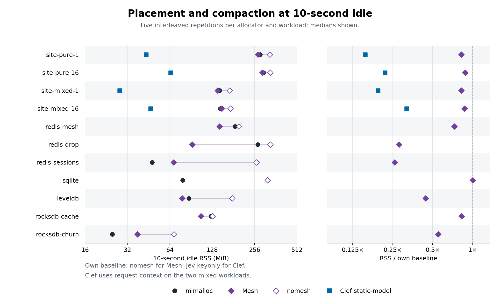
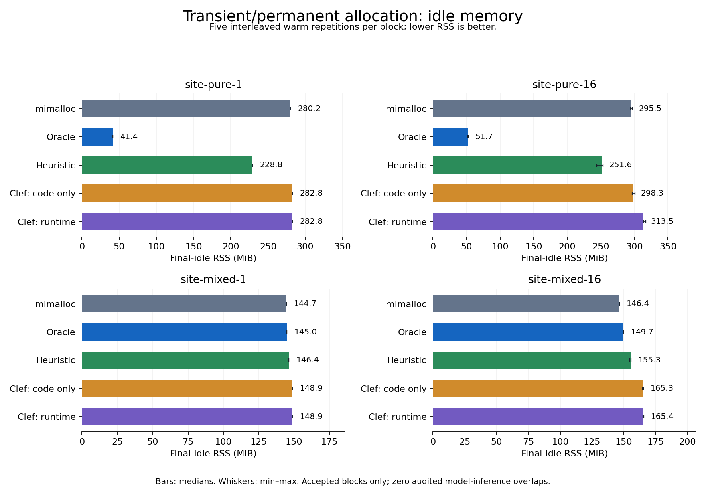

# Pass 10 — answering review 2

This pass asks whether lifetime placement saves memory under mimalloc defaults, whether current runtime statistics help, and whether a model adds value beyond function names and TTL text.

24/25 fragmentation blocks are complete. Every published comparison uses five interleaved repetitions. **Defaults** unsets every `MIMALLOC_*` override; **immediate purge** sets delay 0, arena multiplier 1 and decommit enabled. Full measurements, both cycles and 10-second idle observations are in the [pass-10 report](results/pass10/results.md) and [phase table](results/pass10/phases.md).

Final idle RSS under **defaults**, MiB. Plain mimalloc is `mi`; oracle uses sites on pure workloads and context pairs on mixed. Rules share the model’s placement machinery.

| Workload | mi | Oracle | Static model | Hybrid | Live heuristic | Neutral rules | Names / TTL rule |
|---|---:|---:|---:|---:|---:|---:|---:|
| site-pure-1 | 280.21 | 214.00 | 216.81 | 216.81 | 286.83 | 304.81 | 216.81 |
| site-pure-16 | 296.55 | 234.80 | 239.98 | 241.92 | 305.36 | 331.91 | 239.74 |
| site-mixed-1 | 146.21 | 112.18 | 115.02 | 115.02 | 147.14 | 158.96 | 115.02 |
| site-mixed-16 | 170.53 | 138.91 | 140.07 | 140.12 | 171.24 | 180.02 | 140.07 |

The one-thread pure model reduction is 22.6% under defaults, versus 84.4% with immediate purge. Defaults also adds a 10-second wait between cycles. The fixed names rule produces 216.81 MiB under defaults. The original large synthetic saving is configuration-dependent and does not by itself show a model advantage.

The heuristic now runs on current observations. Neutral rules use a 0.5 prior with hybrid’s continuous checks. Both use more idle RSS than mimalloc in all four named defaults fixtures. Fixed names/TTL rules closely match the useful model placement there.

Static-model retains a positive saving over its own mimalloc baseline in 0/8 renamed comparisons. Exact per-naming RSS, oracle capture and fractions of the original saving are in the full report. Hybrid retains a positive saving in 0/4 opaque comparisons.

With plausible names, hybrid retains 52.3–81.2% of its named saving and beats the matching fixed names/TTL rule by 22.00–54.37 MiB. The model initially chooses transient, but its probability priors permit promotion of the retained path while blocking the session path. Some mixed-context priors lie close to the fixed 0.7 gate. This is a benefit in these specific synthetic ablations; the [answer/probability table](results/pass10/model-sites.md) and full ranges show its scope.

Default-options real programs: 6/7 complete. Model-policy reductions above 5% are absent in the completed workloads. All policies, costs and ranges are in the full report. Earlier table-search gates and the later contrary RocksDB result remain below. Redis drop is a severe failure: live/context static-model holds 4.15 GiB versus mi 274.33 MiB, with 85.2× target CPU. Its roughly 495,000 context entries also burden the no-model live controls. RocksDB cache hybrid holds 1019.11 MiB versus mi 144.25 MiB.

The recollected small per-object run has 94.66% model-answered accuracy versus 91.12% always-transient accuracy, with 39.90% permanent recall. The TTL rule reproduces 2229/2229 model-answered classes. Accuracy, logged checks and separate unlogged RSS/cost comparisons are in the full report. Unlogged per-object idle RSS is immediate: 7.77 versus mi 7.96 MiB; defaults: 8.45 versus mi 8.13 MiB. Fresh cold inference took 50.8 minutes.

The combined logging/live-free bug is fixed. Tests cover cross-thread frees, retired allocating threads, actual address reuse, sample/survivor counts and hybrid demotions with logging on and off. Warm model measurements replay answers and retain service/IPC costs; target CPU excludes sidecar CPU. Compact evidence supports the medians, while full trace/cache reconstruction requires the retained remote artifacts.

<!-- PASS10-END -->

## Historical results (passes 6–9)

Historical configuration for all fragbench tables below: mi means upstream
mimalloc with purge delay 0, arena purge multiplier 1 and decommit enabled.
These historical runs do not measure mimalloc defaults. Every historical
heuristic result below is a **replayed heuristic schedule**: its sparse formula
was not recomputed from warm observations, unlike hybrid's continuous C rules.
They do not establish superiority over a live statistics-only policy.

The synthetic gains use author-designed allocation names or supplied TTL buckets
that reveal the intended lifetime distinction. Earlier passes measured neither
an equally informed names/TTL rule nor a held-out naming/context test.
For server-sim, live bytes count requested workload objects; RSS also includes
bookkeeping mappings, allocator/runtime metadata and thread resources. RSS/live
is process-memory amplification relative to those objects, not fragmentation alone.
Warm replay removes HTTP inference but retains IPC/service costs and excludes
sidecar CPU; it measures this implementation, not end-to-end deployment or
hypothetical on-chip inference. Compact aggregates permit recomputation of medians;
full trace/cache/decision reconstruction requires artifacts not committed here.

# Pass 9 — decisions from live request context

site-mixed-1: context oracle saves 82.0% of mimalloc idle RSS; Clef/context captures 98.3% and hybrid/context 98.3% of that saving. site-mixed-16: context oracle saves 77.2% of mimalloc idle RSS; Clef/context captures 88.8% and hybrid/context 88.3% of that saving. No validated >5% context-table headroom on redis-drop, redis-mesh, redis-sessions. These workloads receive no model decisions.

The context API requires a small change to the application at request dispatch.

Completed context workload blocks: 6/6. Five interleaved warm repetitions per published variant.

| Workload | mi MiB | Per-site oracle | Context oracle | Code-only/site | Clef/context | Hybrid/context | Replayed heuristic schedule/context | Search | Per-alloc |
|---|---:|---:|---:|---:|---:|---:|---:|---:|---:|
| per-alloc-small | 7.96 | 8.05 | 5.11 | — | — | — | — | — | 7.75 |
| redis-drop | 271.20 | 270.55 | 283.78 | — | — | — | — | 285.71 | — |
| redis-mesh | 185.96 | 188.04 | 196.06 | — | — | — | — | 180.01 | — |
| redis-sessions | 48.11 | 50.03 | 50.04 | — | — | — | — | 48.25 | — |
| site-mixed-1 | 144.70 | 145.00 | 26.05 | 146.43 | 28.11 | 28.11 | 146.87 | — | — |
| site-mixed-16 | 146.42 | 149.70 | 33.41 | 154.45 | 46.11 | 46.62 | 167.03 | — | — |

| Workload | Original sites | Context pairs | Distinct signatures | Bytes carrying context |
|---|---:|---:|---:|---:|
| per-alloc-small | 7 | 9 | 4 | 99.64% |
| redis-drop | 629 | 495421 | 160292 | 48.10% |
| redis-mesh | 621 | 626 | 6 | 11.24% |
| redis-sessions | 644 | 662 | 13 | 63.52% |
| site-mixed-1 | 10 | 16 | 4 | 99.98% |
| site-mixed-16 | 10 | 16 | 4 | 99.77% |

| Workload | Policy | Warm wall/mi | CPU/mi | Peak MiB | Cold wall s | Cold+fill HTTP s | Sidecar / model answers | Asked pairs |
|---|---|---:|---:|---:|---:|---:|---:|---:|
| per-alloc-small | jev-live:per-alloc | 1.809 | 32.843 | 8.11 | 3060.34 | 3048.32 | 2229 / 2229 | 3 / 9 |
| site-mixed-1 | jev-live:static-site | 1.072 | 1.571 | 146.48 | 6.86 | 5.45 | 4 / 4 | 4 / 10 |
| site-mixed-1 | jev-live:static-model | 1.082 | 1.636 | 114.61 | 13.69 | 12.25 | 10 / 10 | 10 / 16 |
| site-mixed-1 | jev-live:hybrid | 1.097 | 1.751 | 114.60 | 1.44 | 0.00 | 10 / 10 | 10 / 16 |
| site-mixed-1 | jev-live:heuristic (replayed heuristic schedule) | 1.040 | 1.259 | 146.62 | 1.18 | 0.00 | 34 / 0 | n/a / 16 |
| site-mixed-16 | jev-live:static-site | 1.017 | 1.302 | 156.38 | 1.24 | 0.00 | 4 / 4 | 4 / 10 |
| site-mixed-16 | jev-live:static-model | 1.009 | 1.306 | 126.48 | 1.24 | 0.00 | 10 / 10 | 10 / 16 |
| site-mixed-16 | jev-live:hybrid | 1.009 | 1.380 | 126.86 | 1.25 | 0.00 | 10 / 10 | 10 / 16 |
| site-mixed-16 | jev-live:heuristic (replayed heuristic schedule) | 1.005 | 1.011 | 169.04 | 1.05 | 0.00 | 32 / 0 | n/a / 16 |

Per-allocation accuracy on model-answered objects: 2110/2229 (94.66%). Across all payloads, including the default class before admission: 2225/2400 (92.71%). 185 total objects were not model-answered. The confusion matrix and byte accuracy are in [object-accuracy.json](results/pass9/per-alloc-small/object-accuracy.json).
Cold per-allocation: 2229 model decisions, 2229 HTTP requests, 3048.32 model seconds, 3060.34 wall seconds.
The small experiment has 2,400 payload allocations over two cycles, four times the normal payload size, and omits parsing/response allocations and purge pulses. This allows the rare day-TTL pair to reach admission within a 3,000-decision budget. The historical cold object logger preserved exact lifetimes but skipped live sampled-free updates. The unlogged warm runs restore those updates and differ in 2,214 of 2,229 request states per run. Their size/context/stack sequence is checked, and the model prompt does not consume the changed runtime statistics. Pass 10 fixes and recollects this experiment; these pass-9 numbers retain the defect qualification. Separate five-run warm comparisons disable this logger, retain per-allocation decisions and sampling, and replay the recorded answers; headline RSS and warm timing use those measurements when complete.
An always-transient classifier would score 2031/2229 (91.12%) on the same answered objects. Permanent-object recall is 79/198 (39.90%). A deterministic rule returning permanent for `ttl=day` and transient otherwise reproduces every model-answered payload class. This demonstrates context-conditioned placement, not an advantage from repeated inference over that rule.

At this small scale, per-allocation placement saves 2.6% of mimalloc idle RSS and captures 7.4% of the context oracle's saving. High object accuracy does not imply the same RSS saving: admission leaves early allocations in the default heap, and live-decision machinery has a material fixed cost. The 119 model-answered errors are short-TTL objects that exceed the trace's half-volume lifetime threshold; 56 additional day-TTL payloads precede admission.

At the shared payload stack: no context: transient (P=0.6411); kind=store ttl=0: transient (P=0.6487); kind=store ttl=short: transient (P=0.7178); kind=store ttl=day: permanent (P=0.6189).
Hybrid makes 0 class transitions across 10 warm mixed-workload runs.

The context API requires a small application change. Applications normalize and bucket the supplied text; the library copies 255 bytes plus NUL. Context applies to allocations after the dispatch hook. Redis input parsing precedes the command hook. Some context-bearing value records are logical realloc events during string trimming; the inherited in-place realloc path retains the original physical block. An in-place realloc can receive/log a new policy class while retaining its old physical heap; per-object class accuracy is not always physical-placement accuracy. Context on that later event does not retroactively relocate storage, so trace classification accuracy is not a physical-placement upper bound.

Redis-drop uses colon-free numbered keys. The specified prefix rule retains these identifiers (up to 16 bytes), producing 160,292 signatures and 495,421 pairs. That defeats cache sharing and adds table/key metadata overhead; the key-only control is about 16 MiB above mimalloc. No model was run on this failed-gate workload.

Admission is 64 KiB per (site, context signature), budget 3,000. Cross-thread counter batching can delay admission. Byte coverage includes bytes allocated before an answer; it is not the fraction routed under the model label. Hybrid rules operate per pair. Cached warm runs replay recorded answers without HTTP inference; sampling and hybrid transitions still execute. The per-allocation response cache includes the full allocation request; warm ordinal replay rejects changed size, context or stack. Runtime statistics may drift.

RSS is the final idle phase, not the mean of multiple cycles. Greedy search uses the top 24 byte-heavy pairs, three runs per flip and a >2% training improvement, followed by five independent interleaved comparisons. Redis model runs require >5% validated table savings against mimalloc. Search does not prove an optimum.

CPU time is the workload process user plus system time from wait4; sidecar CPU is excluded. Wall time includes synchronous decision-service delays. Native model HTTP seconds are reported separately.

Exact permanent-pair labels, model probabilities and prompt states: [permanent-pairs.jsonl.gz](results/pass9/permanent-pairs.jsonl.gz). All measured costs: [costs.json](results/pass9/costs.json). Full median/range data: [summary.json](results/pass9/summary.json).

## Mesh compaction comparison

After 10 seconds, Mesh saves more than 5% RSS against nomesh on 10/11 comparable workloads: leveldb, redis-drop, redis-mesh, redis-sessions, rocksdb-cache, rocksdb-churn, site-mixed-1, site-mixed-16, site-pure-1, site-pure-16. Against plain mimalloc, Mesh clears 5% on these real-program workloads: leveldb, redis-drop, redis-mesh, rocksdb-cache. These are descriptive five-run comparisons, not new model-admission gates. Normal and 10-second idle RSS medians are identical in all 77 allocator/workload comparisons.

[Vector figure](results/pass9/compaction-comparison.svg)

11/11 workload blocks processed, with 0 allocator/workload failures. Five interleaved repetitions per reported successful variant. Normal idle and 10-second idle are sampled in the same process; longer idle in the first cycle can affect the next cycle. Wall time includes all common settle periods.

| Workload | Variant | Idle MiB | 10 s idle MiB | Peak MiB | Wall s | CPU s | Idle / mi | Idle / twin | 10 s / twin |
|---|---|---:|---:|---:|---:|---:|---:|---:|---:|
| leveldb | mi | 87.59 | 87.59 | 198.84 | 11.373 | 1.464 | 1.000 | — | — |
| leveldb | jev-keyonly | 87.72 | 87.72 | 199.15 | 11.375 | 1.510 | 1.001 | 1.000 | 1.000 |
| leveldb | jev-table:oracle-site | 87.92 | 87.92 | 199.45 | 11.369 | 1.483 | 1.004 | 1.002 | 1.002 |
| leveldb | mesh | 78.43 | 78.43 | 236.90 | 11.444 | 1.454 | 0.895 | 0.442 | 0.442 |
| leveldb | nomesh | 177.30 | 177.30 | 237.11 | 11.431 | 1.401 | 2.024 | 1.000 | 1.000 |
| redis-drop | mi | 269.41 | 269.41 | 275.82 | 11.916 | 0.336 | 1.000 | — | — |
| redis-drop | jev-keyonly | 285.60 | 285.60 | 291.98 | 12.006 | 0.536 | 1.060 | 1.000 | 1.000 |
| redis-drop | jev-table:oracle-site | 270.20 | 270.20 | 278.00 | 11.947 | 0.408 | 1.003 | 0.946 | 0.946 |
| redis-drop | jev-table:oracle-context | 284.31 | 284.31 | 293.91 | 12.012 | 0.528 | 1.055 | 0.995 | 0.995 |
| redis-drop | jev-table:search | 286.48 | 286.48 | 293.91 | 12.007 | 0.532 | 1.063 | 1.003 | 1.003 |
| redis-drop | mesh | 92.40 | 92.40 | 330.32 | 12.069 | 0.886 | 0.343 | 0.279 | 0.279 |
| redis-drop | nomesh | 331.20 | 331.20 | 330.50 | 11.972 | 0.530 | 1.229 | 1.000 | 1.000 |
| redis-mesh | mi | 185.98 | 185.98 | 185.92 | 22.825 | 1.354 | 1.000 | — | — |
| redis-mesh | jev-keyonly | 186.05 | 186.05 | 185.82 | 23.279 | 1.779 | 1.000 | 1.000 | 1.000 |
| redis-mesh | jev-table:oracle-site | 188.01 | 188.01 | 187.95 | 23.134 | 1.660 | 1.011 | 1.010 | 1.010 |
| redis-mesh | jev-table:oracle-context | 196.07 | 196.07 | 196.00 | 23.129 | 1.655 | 1.054 | 1.054 | 1.054 |
| redis-mesh | jev-table:search | 186.09 | 186.09 | 185.98 | 23.160 | 1.702 | 1.001 | 1.000 | 1.000 |
| redis-mesh | mesh | 144.56 | 144.56 | 188.70 | 23.485 | 2.134 | 0.777 | 0.729 | 0.729 |
| redis-mesh | nomesh | 198.40 | 198.40 | 198.00 | 23.237 | 1.803 | 1.067 | 1.000 | 1.000 |
| redis-sessions | mi | 48.03 | 48.03 | 201.72 | 13.211 | 0.363 | 1.000 | — | — |
| redis-sessions | jev-keyonly | 48.21 | 48.21 | 201.96 | 13.198 | 0.425 | 1.004 | 1.000 | 1.000 |
| redis-sessions | jev-table:oracle-site | 50.02 | 50.02 | 203.75 | 13.266 | 0.420 | 1.041 | 1.038 | 1.038 |
| redis-sessions | jev-table:oracle-context | 50.02 | 50.02 | 203.99 | 13.266 | 0.422 | 1.041 | 1.037 | 1.037 |
| redis-sessions | jev-table:search | 48.20 | 48.20 | 201.95 | 13.264 | 0.421 | 1.004 | 1.000 | 1.000 |
| redis-sessions | mesh | 68.25 | 68.25 | 269.11 | 13.480 | 0.754 | 1.421 | 0.259 | 0.259 |
| redis-sessions | nomesh | 264.00 | 264.00 | 270.29 | 13.289 | 0.512 | 5.496 | 1.000 | 1.000 |
| rocksdb-cache | mi | 125.15 | 125.15 | 140.79 | 15.244 | 63.573 | 1.000 | — | — |
| rocksdb-cache | jev-keyonly | 128.47 | 128.47 | 132.09 | 15.052 | 63.450 | 1.027 | 1.000 | 1.000 |
| rocksdb-cache | jev-table:oracle-site | 114.58 | 114.58 | 129.35 | 15.209 | 63.482 | 0.916 | 0.892 | 0.892 |
| rocksdb-cache | mesh | 106.54 | 106.54 | 119.70 | 15.127 | 62.509 | 0.851 | 0.826 | 0.826 |
| rocksdb-cache | nomesh | 129.02 | 129.02 | 128.00 | 14.914 | 61.904 | 1.031 | 1.000 | 1.000 |
| rocksdb-churn | mi | 24.96 | 24.96 | 102.75 | 95.308 | 271.123 | 1.000 | — | — |
| rocksdb-churn | jev-keyonly | 25.22 | 25.22 | 100.05 | 92.909 | 259.962 | 1.010 | 1.000 | 1.000 |
| rocksdb-churn | jev-table:oracle-site | 26.25 | 26.25 | 105.30 | 93.031 | 271.983 | 1.052 | 1.041 | 1.041 |
| rocksdb-churn | mesh | 37.67 | 37.67 | 71.21 | 92.487 | 249.609 | 1.509 | 0.550 | 0.550 |
| rocksdb-churn | nomesh | 68.52 | 68.52 | 84.49 | 91.235 | 245.783 | 2.745 | 1.000 | 1.000 |
| site-mixed-1 | mi | 144.70 | 144.70 | 145.81 | 20.651 | 0.150 | 1.000 | — | — |
| site-mixed-1 | jev-keyonly | 144.80 | 144.80 | 145.90 | 20.725 | 0.224 | 1.001 | 1.000 | 1.000 |
| site-mixed-1 | jev-table:oracle-site | 145.00 | 145.00 | 145.95 | 20.715 | 0.213 | 1.002 | 1.001 | 1.001 |
| site-mixed-1 | jev-table:oracle-context | 26.05 | 26.05 | 111.95 | 20.728 | 0.225 | 0.180 | 0.180 | 0.180 |
| site-mixed-1 | jev-live:static-site | 146.46 | 146.46 | 146.61 | 20.743 | 0.234 | 1.012 | 1.011 | 1.011 |
| site-mixed-1 | jev-live:static-model | 28.12 | 28.12 | 114.63 | 20.768 | 0.261 | 0.194 | 0.194 | 0.194 |
| site-mixed-1 | jev-live:hybrid | 28.12 | 28.12 | 114.61 | 20.760 | 0.253 | 0.194 | 0.194 | 0.194 |
| site-mixed-1 | jev-live:heuristic (replayed heuristic schedule) | 146.87 | 146.87 | 146.61 | 20.683 | 0.168 | 1.015 | 1.014 | 1.014 |
| site-mixed-1 | mesh | 139.98 | 139.98 | 142.00 | 20.836 | 0.330 | 0.967 | 0.822 | 0.822 |
| site-mixed-1 | nomesh | 170.27 | 170.27 | 170.00 | 20.687 | 0.185 | 1.177 | 1.000 | 1.000 |
| site-mixed-16 | mi | 146.42 | 146.42 | 148.95 | 20.550 | 0.446 | 1.000 | — | — |
| site-mixed-16 | jev-keyonly | 146.82 | 146.82 | 151.41 | 20.559 | 0.580 | 1.003 | 1.000 | 1.000 |
| site-mixed-16 | jev-table:oracle-site | 149.71 | 149.71 | 152.07 | 20.558 | 0.538 | 1.022 | 1.020 | 1.020 |
| site-mixed-16 | jev-table:oracle-context | 33.52 | 33.52 | 117.38 | 20.550 | 0.565 | 0.229 | 0.228 | 0.228 |
| site-mixed-16 | jev-live:static-site | 154.62 | 154.62 | 153.83 | 20.565 | 0.571 | 1.056 | 1.053 | 1.053 |
| site-mixed-16 | jev-live:static-model | 46.73 | 46.73 | 127.14 | 20.559 | 0.591 | 0.319 | 0.318 | 0.318 |
| site-mixed-16 | jev-live:hybrid | 47.33 | 47.33 | 127.14 | 20.561 | 0.623 | 0.323 | 0.322 | 0.322 |
| site-mixed-16 | jev-live:heuristic (replayed heuristic schedule) | 165.64 | 165.64 | 169.20 | 20.555 | 0.446 | 1.131 | 1.128 | 1.128 |
| site-mixed-16 | mesh | 149.88 | 149.88 | 147.68 | 20.695 | 0.461 | 1.024 | 0.868 | 0.868 |
| site-mixed-16 | nomesh | 172.70 | 172.70 | 171.62 | 20.607 | 0.360 | 1.179 | 1.000 | 1.000 |
| site-pure-1 | mi | 280.22 | 280.22 | 280.02 | 20.589 | 0.087 | 1.000 | — | — |
| site-pure-1 | jev-keyonly | 280.31 | 280.31 | 280.25 | 20.629 | 0.128 | 1.000 | 1.000 | 1.000 |
| site-pure-1 | jev-table:oracle-site | 41.37 | 41.37 | 213.94 | 20.730 | 0.229 | 0.148 | 0.148 | 0.148 |
| site-pure-1 | jev-live:static-model | 43.56 | 43.56 | 216.59 | 20.759 | 0.252 | 0.155 | 0.155 | 0.155 |
| site-pure-1 | jev-live:hybrid | 43.57 | 43.57 | 216.67 | 20.765 | 0.261 | 0.155 | 0.155 | 0.155 |
| site-pure-1 | jev-live:heuristic (replayed heuristic schedule) | 228.50 | 228.50 | 286.65 | 20.674 | 0.164 | 0.815 | 0.815 | 0.815 |
| site-pure-1 | mesh | 270.62 | 270.62 | 270.14 | 21.036 | 0.530 | 0.966 | 0.823 | 0.823 |
| site-pure-1 | nomesh | 328.86 | 328.86 | 328.50 | 20.759 | 0.258 | 1.174 | 1.000 | 1.000 |
| site-pure-16 | mi | 296.55 | 296.55 | 298.33 | 20.543 | 0.462 | 1.000 | — | — |
| site-pure-16 | jev-keyonly | 295.95 | 295.95 | 298.73 | 20.548 | 0.517 | 0.998 | 1.000 | 1.000 |
| site-pure-16 | jev-table:oracle-site | 51.83 | 51.83 | 221.76 | 20.556 | 0.636 | 0.175 | 0.175 | 0.175 |
| site-pure-16 | jev-live:static-model | 64.86 | 64.86 | 232.77 | 20.562 | 0.671 | 0.219 | 0.219 | 0.219 |
| site-pure-16 | jev-live:hybrid | 63.38 | 63.38 | 232.03 | 20.567 | 0.693 | 0.214 | 0.214 | 0.214 |
| site-pure-16 | jev-live:heuristic (replayed heuristic schedule) | 255.43 | 255.43 | 298.70 | 20.562 | 0.530 | 0.861 | 0.863 | 0.863 |
| site-pure-16 | mesh | 290.95 | 290.95 | 288.62 | 20.837 | 0.710 | 0.981 | 0.878 | 0.878 |
| site-pure-16 | nomesh | 331.42 | 331.42 | 330.12 | 20.675 | 0.511 | 1.118 | 1.000 | 1.000 |
| sqlite | mi | 78.94 | 78.94 | 205.80 | 10.147 | 0.146 | 1.000 | — | — |
| sqlite | jev-keyonly | 79.01 | 79.01 | 205.79 | 10.154 | 0.154 | 1.001 | 1.000 | 1.000 |
| sqlite | jev-table:oracle-site | 82.10 | 82.10 | 209.01 | 10.134 | 0.133 | 1.040 | 1.039 | 1.039 |
| sqlite | mesh | 317.53 | 317.53 | 317.12 | 10.439 | 0.439 | 4.023 | 1.000 | 1.000 |
| sqlite | nomesh | 317.52 | 317.52 | 317.25 | 10.295 | 0.294 | 4.022 | 1.000 | 1.000 |

Twin is nomesh for both Mesh variants, jev-keyonly for placement policies. Each allocator has its own baseline; a Mesh/mi difference alone does not isolate compaction. CPU is workload-process user plus system time, excluding the sidecar. Full ranges and all costs are in [compaction-summary.json](results/pass9/compaction-summary.json).

The later RocksDB-cache per-site oracle median is 8.4% below mimalloc, with run ranges 111.11–128.12 MiB (oracle) and 123.33–137.04 MiB (mimalloc). The intervals overlap. This uses a new trace and the longer-settle workload; the earlier independent headroom gate is retained separately, and no additional database context/model experiment was added.

Mesh source revision: `2987f883b8695c07a80dc40da67c61f524460dfd` (the recipe follows master). Default randomization is unchanged; the twin differs by `DISABLE_MESHING=ON`. Dependency archives retain the exact pinned revisions. Build logs, hashes and the CMake dependency-fetch adaptation are in [builds](results/pass9/builds).
This revision checks a 100 ms meshing interval on eligible frees; it does not run a background compaction thread during a completely quiet idle. Waiting longer alone therefore need not trigger another mesh pass.
These are process RSS measurements, as requested. RSS counts resident mappings; PSS apportions shared pages across mappings ([Linux kernel documentation](https://www.kernel.org/doc/html/latest/filesystems/proc.html)). Because Mesh preserves virtual addresses by aliasing physical pages, RSS alone can understate its physical-memory benefit. This experiment does not measure PSS and does not equate unchanged RSS with zero physical compaction.

Upstream unit checks pass in both configurations (meshing-specific tests are skipped by nomesh). The measured library hashes were verified unchanged before and after the checks. Logs: [Mesh](results/pass9/builds/mesh-unit.log), [nomesh](results/pass9/builds/nomesh-unit.log).

## Earlier passes (history)

# Pass 8 — model priors, runtime evidence, and real programs

**Status: 2/2 site-pure blocks; 7/7 real-program workload blocks; 22/22 regression workloads complete and audited.**

The question is whether a code-only Clef-Flash lifetime prior can separate heap allocations well enough to reduce memory after load drops, and whether observed frees can safely correct it. Hybrid asks the model once per admitted site, then applies fixed runtime rules. Pass 7’s repeatedly queried policy remains available as `model-reask`; it was not rerun.

site-pure-1: hybrid 43.57 MiB, static-model 43.56 MiB, heuristic 228.55 MiB; hybrid captures 99.1% of the best table’s saving.
site-pure-16: hybrid 63.27 MiB, static-model 63.55 MiB, heuristic 260.22 MiB; hybrid captures 95.2% of the best table’s saving.

**Neither tested table cleared the 5% gate in the original five-run comparison on any of seven real workloads:** leveldb, redis-drop, redis-mesh, redis-sessions, rocksdb-cache, rocksdb-churn, sqlite. Neither table saved more than 5%, so these workloads received no model decisions. This is not a bound over all per-site policies; the later RocksDB-cache oracle comparison has an 8.4% lower median.

“No per-site headroom” means neither tested table cleared 5%; it is not a proof over all possible labellings. Search training uses three runs per flip and a strict >2% improvement. In the cache-heavy RocksDB case, training gains failed independent validation amid substantial run variability. Headline measurements are five separate interleaved runs. The oracle is a lifetime-majority table, not an RSS optimum.

Wrong permanent priors occur in 12/22 regression workloads. Hybrid demotes many, but RSS effects are mixed and allocator overhead remains severe: sh6benchN costs 35.3× mimalloc, versus 13.1× for static-model. The acceptance targets do not all pass. This is a fix for the site-pure classification regression, with no demonstrated benefit on the seven real-program fragmentation cases.

## Idle RSS

| Workload | mi MiB | Oracle MiB | Search MiB | Best table saving | Static MiB / capture | Hybrid MiB / capture | Replayed heuristic schedule MiB / capture |
|---|---:|---:|---:|---:|---:|---:|---:|
| site-pure-1 | 280.22 | 41.32 | — | 85.3% | 43.56 / 99.1% | 43.57 / 99.1% | 228.55 / 21.6% |
| site-pure-16 | 296.55 | 51.45 | — | 82.6% | 63.55 / 95.1% | 63.27 / 95.2% | 260.22 / 14.8% |
| leveldb | 87.61 | 87.93 | 87.80 | -0.2% | — | — | — |
| redis-drop | 270.71 | 271.04 | 271.00 | -0.1% | — | — | — |
| redis-mesh | 185.85 | 185.96 | 186.06 | -0.1% | — | — | — |
| redis-sessions | 48.04 | 49.96 | 48.19 | -0.3% | — | — | — |
| rocksdb-cache | 121.97 | 132.64 | 126.64 | -3.8% | — | — | — |
| rocksdb-churn | 24.88 | 25.93 | 25.11 | -1.0% | — | — | — |
| sqlite | 78.95 | 82.07 | 79.01 | -0.1% | — | — | — |

### Model decisions on real stacks

No real-program table passed the headroom gate, so the requested rule prevented model evaluation on these stacks.

### Wrong permanent priors

For example, hybrid lowers glibc-thread peak RSS from 95.30 to 69.16 MiB, but its inverse-throughput score rises from 3.26× to 6.69× mimalloc. That duration-limited comparison also changes completed work. Rptest peak RSS increases from 159.88 to 193.83 MiB. The lower mleak100 median has overlapping five-run ranges. These results do not establish a general RSS benefit from correcting priors.

Counts below compare first-sight static-model answers to the prior trace lifetime oracle. They identify candidate corrections; measured RSS determines whether hybrid helped. Regression RSS is peak rather than idle.

| Workload | Asked sites | Wrong permanent | Wrong sites demoted in hybrid (median) | Hybrid/static peak RSS |
|---|---:|---:|---:|---:|
| cfrac | 66 | 64 | 64 | 1.001 |
| espresso | 500 | 374 | 315 | 1.004 |
| barnes | 0 | 0 | 0 | 0.999 |
| larson | 4 | 2 | 2 | 1.207 |
| larson-sized | 4 | 0 | 0 | 1.001 |
| xmalloc-test | 2 | 0 | 0 | 0.997 |
| cache-scratch1 | 0 | 0 | 0 | 0.979 |
| cache-scratchN | 0 | 0 | 0 | 1.001 |
| cache-thrash1 | 0 | 0 | 0 | 1.000 |
| cache-thrashN | 0 | 0 | 0 | 0.979 |
| mstress | 20 | 1 | 0 | 0.984 |
| rptest | 7 | 7 | 6 | 1.212 |
| glibc-simple | 31 | 31 | 31 | 1.037 |
| glibc-thread | 1 | 1 | 1 | 0.726 |
| alloc-test1 | 2 | 0 | 0 | 1.008 |
| alloc-testN | 3 | 0 | 0 | 1.007 |
| malloc-large | 1 | 1 | 1 | 1.000 |
| mleak10 | 2 | 2 | 1 | 1.322 |
| mleak100 | 3 | 2 | 1 | 0.773 |
| sh6benchN | 1 | 1 | 1 | 0.933 |
| sh8benchN | 2 | 2 | 2 | 1.269 |
| redis | 7 | 0 | 0 | 1.000 |

Demotion counts include only sites with the same wrong permanent prior in hybrid, and may include shutdown. They do not establish that a correction happened before peak RSS. Exact wrong-prior probabilities, stacks and per-run hybrid counters are in [wrong-priors.json](results/pass8/wrong-priors.json).

Capture = (mi − policy)/(mi − best table), undefined without positive savings. Fragmentation RSS uses the final idle point; site-pure has two cycles. Model timings replay first-sight answers, while hybrid runtime rules execute afresh during each run. No inference is included in warm headline timing. Target-process CPU excludes the model server and, for Redis, the separate client driver; wall time includes the common settle period.

## Time and model coverage

| Workload | Policy | Wall/mi | CPU/mi | Cold wall s | Cold+fill HTTP s | Asked sites | Byte coverage | Runtime demotions |
|---|---|---:|---:|---:|---:|---:|---:|---:|
| site-pure-1 | static-model | 1.145 | 2.776 | 1.43 | 0.00 | 5 | 100.00% | 0 |
| site-pure-1 | hybrid | 1.155 | 2.907 | 1.43 | 0.00 | 5 | 100.00% | 0 |
| site-pure-1 | replayed heuristic schedule | 1.073 | 1.817 | 1.17 | 0.00 | n/a | n/a | 0 |
| site-pure-16 | static-model | 1.021 | 1.468 | 1.25 | 0.00 | 5 | 100.00% | 0 |
| site-pure-16 | hybrid | 1.022 | 1.488 | 1.24 | 0.00 | 5 | 100.00% | 0 |
| site-pure-16 | replayed heuristic schedule | 1.019 | 1.197 | 1.06 | 0.00 | n/a | n/a | 0 |

Runtime demotions above include process shutdown and therefore do not by themselves establish a useful wrong-prior correction. Per-site model probabilities and the exact stack state seen are recorded in [site-decisions.json](results/pass8/site-decisions.json). Search candidates and accepted moves, by function stack, are in [search.md](results/pass8/search.md). Full ranges, program memory, peak RSS and costs are in [details.md](results/pass8/details.md).

## Runtime rule and method

[Final evidence validation](results/pass8/validation.json) recomputes all search decisions and gates and verifies the measured library fingerprints. All 525 retained greedy-search trials also pass the [independent inference audit](results/pass8/search-intervals.inference-audit.json).

Measured allocator SHA-256: `e6ffcfc52823ef422a8565967bccf7986d86ac6e0de6057f13bc5b40681fa48e`. Full Linux correctness passed for 22 workloads, with separate hybrid integration, stack, fragmentation and final-idle metric tests. Published warm matrices have matching independent audit hashes and zero inference overlap.

First sight is exactly stack-v1/static-model, including a neutral program description and up to 12 function/file/line frames, without source. Admission is 64 KiB of successful requested bytes, budget 1,500. Unknown sites remain transient. Both prior probabilities are logged. All pass-8 model answers reused the shared exact-payload cache, so native HTTP inference time was zero, including coverage fills. This pass does not measure fresh-model inference latency. Cache hits still consume budget. Cold wall time includes stack symbolization and sidecar work, while HTTP inference time is reported separately. A one-shot allocation can still escape next-allocation admission. Byte coverage counts all requested bytes at answered sites, including allocations before the answer; it is not the fraction allocated under a model label. Published live counters and the allocation clock are batched and approximate.

Hybrid demotes when at least 16 samples exist and at least 5% of all sampled requested bytes have been freed. Promotion requires no sampled object ever freed, P(transient)<0.7, oldest live reservoir sample older than half the allocation clock, and clock >=64 MiB. Exact cumulative sampled free totals survive reservoir replacement and thread retirement; ages use a 128-entry reservoir and the batched allocation clock. Checks occur on sampled allocations/frees and first-prior arrival. A class change affects future allocations, not existing objects. Unit tests cover threshold boundaries; allocator integration tests cover sample rates 1 and 64, confident transient retention, ambiguous promotion, and wrong-prior demotion without reasking.

The first Redis Mesh search mistakenly averaged its two idle phases. Its entire search and final gate were rerun using final idle; the superseded pilot is archived under results/pass8/redis-mesh-average-idle/ and excluded here. The other six real workloads have one idle phase and are unaffected.

All fragbench variants set MIMALLOC_PURGE_DELAY=0, MIMALLOC_ARENA_PURGE_MULT=1, MIMALLOC_PURGE_DECOMMITS=1; real-program settle time is 500 ms. SQLite reports sqlite3_memory_used. Redis reports used_memory, including metadata/usable sizes. RocksDB sums its memtable, table-reader and block-cache properties, and LevelDB reports approximate-memory-usage; these two are partial estimates, so RSS/live is not an exact fragmentation factor. Sources and build recipes are pinned in scripts/build-real.sh, with source/binary hashes in results/pass8/builds/. No system packages are installed.

## Regression

22/22 workloads complete and independently audited. Peak RSS here is a regression metric, not idle fragmentation. Score is inverse throughput for duration-limited workloads, otherwise elapsed time.

| Workload | mi peak MiB | Static peak MiB | Hybrid peak MiB | Replayed heuristic schedule peak MiB | Static score/mi | Hybrid score/mi | Replayed heuristic schedule score/mi |
|---|---:|---:|---:|---:|---:|---:|---:|
| cfrac | 4.273 | 7.449 | 7.453 | 7.445 | 1.888 | 1.988 | 1.908 |
| espresso | 10.141 | 22.965 | 23.059 | 18.852 | 1.466 | 1.488 | 1.555 |
| barnes | 63.340 | 65.570 | 65.512 | 65.570 | 0.998 | 1.001 | 1.001 |
| larson | 157.902 | 182.836 | 220.727 | 218.863 | 2.087 | 3.507 | 2.097 |
| larson-sized | 154.465 | 182.730 | 182.867 | 218.758 | 2.082 | 3.501 | 2.116 |
| xmalloc-test | 134.453 | 93.734 | 93.469 | 99.605 | 4.831 | 10.149 | 4.791 |
| cache-scratch1 | 6.227 | 5.973 | 5.848 | 5.848 | 0.994 | 1.013 | 1.004 |
| cache-scratchN | 6.105 | 6.094 | 6.098 | 5.973 | 1.004 | 1.006 | 0.995 |
| cache-thrash1 | 6.227 | 5.973 | 5.973 | 5.969 | 1.035 | 1.048 | 1.030 |
| cache-thrashN | 6.105 | 6.094 | 5.969 | 6.020 | 1.005 | 1.004 | 1.010 |
| mstress | 521.242 | 633.559 | 623.285 | 651.371 | 1.059 | 1.086 | 1.084 |
| rptest | 110.629 | 159.875 | 193.832 | 133.840 | 1.037 | 1.062 | 1.034 |
| glibc-simple | 5.902 | 6.676 | 6.926 | 6.789 | 1.980 | 2.208 | 2.019 |
| glibc-thread | 68.371 | 95.305 | 69.160 | 69.184 | 3.261 | 6.692 | 3.377 |
| alloc-test1 | 15.105 | 15.973 | 16.098 | 16.223 | 1.499 | 1.565 | 1.505 |
| alloc-testN | 16.434 | 19.344 | 19.473 | 24.223 | 1.803 | 2.841 | 1.812 |
| malloc-large | 649.863 | 640.051 | 640.055 | 639.926 | 1.000 | 1.012 | 1.010 |
| mleak10 | 16.105 | 33.410 | 44.152 | 44.215 | 1.394 | 1.407 | 1.383 |
| mleak100 | 24.164 | 44.223 | 34.203 | 42.227 | 1.343 | 1.343 | 1.369 |
| sh6benchN | 250.719 | 251.234 | 234.496 | 255.477 | 13.093 | 35.287 | 13.121 |
| sh8benchN | 210.637 | 215.863 | 273.992 | 220.008 | 9.181 | 20.217 | 9.184 |
| redis | 13.852 | 20.758 | 20.762 | 20.184 | 1.400 | 1.482 | 1.455 |

All 12 regression variants, warm wall/CPU ranges and peak RSS ranges are in [the full regression table](results/pass8/pass8-regression.md). Duration-limited peak-RSS comparisons also change the amount of work completed.

### Regression model cost and coverage

| Workload | Policy | Cold wall s | Cold+fill HTTP s | Asked sites | Cold byte coverage |
|---|---|---:|---:|---:|---:|
| cfrac | static-model | 5.50 | 0.00 | 66 | 99.96% |
| cfrac | hybrid | 5.68 | 0.00 | 66 | 99.96% |
| espresso | static-model | 6.38 | 0.00 | 500 | 99.80% |
| espresso | hybrid | 6.51 | 0.00 | 500 | 99.80% |
| barnes | static-model | 1.82 | 0.00 | 0 | 0.00% |
| barnes | hybrid | 1.82 | 0.00 | 0 | 0.00% |
| larson | static-model | 7.14 | 0.00 | 4 | 100.00% |
| larson | hybrid | 7.14 | 0.00 | 4 | 100.00% |
| larson-sized | static-model | 7.14 | 0.00 | 4 | 100.00% |
| larson-sized | hybrid | 7.13 | 0.00 | 4 | 100.00% |
| xmalloc-test | static-model | 5.04 | 0.00 | 2 | 100.00% |
| xmalloc-test | hybrid | 5.04 | 0.00 | 2 | 100.00% |
| cache-scratch1 | static-model | 2.67 | 0.00 | 0 | 0.00% |
| cache-scratch1 | hybrid | 2.56 | 0.00 | 0 | 0.00% |
| cache-scratchN | static-model | 0.13 | 0.00 | 0 | 0.00% |
| cache-scratchN | hybrid | 0.13 | 0.00 | 0 | 0.00% |
| cache-thrash1 | static-model | 2.81 | 0.00 | 0 | 0.00% |
| cache-thrash1 | hybrid | 2.78 | 0.00 | 0 | 0.00% |
| cache-thrashN | static-model | 0.14 | 0.00 | 0 | 0.00% |
| cache-thrashN | hybrid | 0.13 | 0.00 | 0 | 0.00% |
| mstress | static-model | 1.07 | 0.00 | 20 | 100.00% |
| mstress | hybrid | 1.07 | 0.00 | 20 | 100.00% |
| rptest | static-model | 16.02 | 0.00 | 7 | 100.00% |
| rptest | hybrid | 16.02 | 0.00 | 7 | 100.00% |
| glibc-simple | static-model | 3.00 | 0.00 | 31 | 100.00% |
| glibc-simple | hybrid | 3.32 | 0.00 | 31 | 100.00% |
| glibc-thread | static-model | 2.01 | 0.00 | 1 | 100.00% |
| glibc-thread | hybrid | 2.01 | 0.00 | 1 | 100.00% |
| alloc-test1 | static-model | 3.15 | 0.00 | 2 | 99.69% |
| alloc-test1 | hybrid | 3.31 | 0.00 | 2 | 99.69% |
| alloc-testN | static-model | 5.30 | 0.00 | 3 | 99.98% |
| alloc-testN | hybrid | 8.23 | 0.00 | 3 | 99.98% |
| malloc-large | static-model | 0.44 | 0.00 | 1 | 100.00% |
| malloc-large | hybrid | 0.44 | 0.00 | 1 | 100.00% |
| mleak10 | static-model | 0.41 | 0.00 | 2 | 97.15% |
| mleak10 | hybrid | 0.42 | 0.00 | 2 | 97.15% |
| mleak100 | static-model | 1.48 | 0.00 | 3 | 99.97% |
| mleak100 | hybrid | 1.45 | 0.00 | 3 | 99.97% |
| sh6benchN | static-model | 2.22 | 0.00 | 1 | 100.00% |
| sh6benchN | hybrid | 5.70 | 0.00 | 1 | 100.00% |
| sh8benchN | static-model | 4.04 | 0.00 | 2 | 99.64% |
| sh8benchN | hybrid | 8.68 | 0.00 | 2 | 99.64% |
| redis | static-model | 4.75 | 0.00 | 7 | 99.98% |
| redis | hybrid | 4.68 | 0.00 | 7 | 99.98% |

### Acceptance target misses

These are diagnostic thresholds, not evidence of statistical significance. All misses remain visible. `none_time` is jev-none/mi score; `none_rss` is jev-none/mi peak RSS; `keyonly_rss` is jev-keyonly/jev-none peak RSS. The inherited `live_time` check is heuristic/oracle score; hybrid costs appear in the regression table above.

| Workload | Check | Ratio | Target |
|---|---|---:|---:|
| cfrac | keyonly_rss | 1.032 | 1.03 |
| larson | live_time | 1.244 | 1.15 |
| larson-sized | live_time | 1.263 | 1.15 |
| xmalloc-test | live_time | 2.123 | 1.15 |
| cache-thrash1 | none_time | 1.034 | 1.03 |
| cache-thrashN | keyonly_rss | 1.058 | 1.03 |
| mleak10 | none_rss | 1.493 | 1.03 |
| sh6benchN | live_time | 4.542 | 1.15 |
| sh8benchN | live_time | 3.635 | 1.15 |

The original pass-7 regression had already completed when pass 8 inspected the remote host. Its raw logs and aggregates were preserved under results/pass7-regression-partial/ with an explanatory archive note. No running matrix needed stopping. Pass-7 results below are historical and use the repeatedly queried `model` policy (now named `model-reask`).

## Earlier passes (history)
# Pass 7 — stack-only live classification

**Status: 12/12 fragbench prompt/workload blocks; 22/22 regression workloads complete and audited.** Five interleaved warm repetitions per variant. Pass-6 results below remain the historical `v-permanent-1` measurement.

Measured library SHA-256: `cae42e81344dd0838d08f595627fda1256a21eca6a15f2b0251ab7c5d478ca92`. Full Linux correctness passed for all 22 workloads.

Code-only Clef captures 99.1% of the oracle idle-RSS saving on site-pure with one thread and 94.0% with 16 threads; omitting the description gives 99.1% and 94.8%. All five queried first-sight sites agree with the oracle. Runtime Clef captures only 20.6% and 14.2%: the requested confidence/age gate still admits an early, incorrect session promotion before any session ends. Redis model byte coverage rises from about 2% in pass 6 to about 99.8%; neither the mixed-site nor Redis fragmentation workloads show positive oracle savings. Timing costs and acceptance-target misses are reported below without further prompt or policy tuning.

The default `stack-v1` includes a neutral hand-written program description and up to 12 function/file/line stack frames, without source. `stack-v1-nodesc` omits the description. The old descriptions are retained verbatim in `descriptions-leaky/`; the old prompt was not rerun. The two new prompt variants isolate the description in first-sight context; comparisons with pass 6 also include the byte gate, budget and runtime-policy changes, so they are not a source-only causal ablation. Site keys remain four frames. The oracle remains the prior-trace byte-majority transient/permanent label (permanent = never freed or alive through more than half the final allocation volume).

All live policies admit a site only after at least 64 KiB of successful requested bytes; smaller sites remain transient. Admission is checked before the next allocation after crossing the threshold. A one-shot large allocation can therefore remain unasked; Barnes is an observed 0%-coverage case with six large one-allocation sites. Counter batching can also delay admission. Each cold model schedule has 1,500 slots shared with replay coverage fills, including cached answers and rechecks. Byte coverage counts all requested bytes from sites with a model-backed answer, including bytes allocated before the answer; it is not the fraction allocated after classification. Published totals can omit up to 4,095 unmerged allocations per still-active thread/site at exit; sample clocks and concurrent snapshots are approximate.

For an initially transient site, runtime Clef can promote to permanent only with permanent probability at least 0.8 and oldest still-live reservoir sample age strictly above one quarter of the current requested-byte clock. The heuristic uses a uniform 128-entry reservoir, requires at least 16 entries, and examines entries strictly older than the lower count-median age: permanent requires less than 5% freed requested bytes in that cohort AND the same age gate. Otherwise transient. Freed entries remain in the reservoir; sample selection is independent of survival. Age uses surviving reservoir entries and the batched clock, not the final run length.

Headline timings replay recorded decisions with unchanged live sampling and no inference. Cold inference and coverage-fill costs are separate below. Missing-slot probes are excluded and retried after fills. Warm request state can drift from the cold state: replay measures the recorded policy, not whether fresh inference would repeat its answers. Model-server memory is excluded. Five observations give medians and ranges, not equivalence claims. Settle time is included in fragbench wall time. The independent server-log audit found no inference overlap in the published warm runs.

## Fragmentation

| Prompt | Workload | mi idle MiB | Oracle MiB | Oracle saving | Code-only MiB / capture | Runtime MiB / capture | Replayed heuristic schedule MiB / capture |
|---|---|---:|---:|---:|---:|---:|---:|
| stack-v1 | site-pure-1 | 280.22 | 41.36 | 85.2% | 43.57 / 99.1% | 231.13 / 20.6% | 228.54 / 21.6% |
| stack-v1 | site-pure-16 | 296.55 | 51.68 | 82.6% | 66.36 / 94.0% | 261.70 / 14.2% | 262.83 / 13.8% |
| stack-v1-nodesc | site-pure-1 | 280.21 | 41.33 | 85.3% | 43.57 / 99.1% | 231.13 / 20.5% | 228.51 / 21.6% |
| stack-v1-nodesc | site-pure-16 | 296.55 | 51.53 | 82.6% | 64.27 / 94.8% | 260.20 / 14.8% | 261.50 / 14.3% |
| stack-v1 | site-mixed-1 | 144.70 | 144.98 | -0.2% | 146.36 / n/a | 154.28 / n/a | 146.43 / n/a |
| stack-v1 | site-mixed-16 | 146.43 | 149.67 | -2.2% | 154.39 / n/a | 164.95 / n/a | 154.89 / n/a |
| stack-v1 | redis-mesh | 183.95 | 185.96 | -1.1% | 192.90 / n/a | 224.95 / n/a | 226.93 / n/a |
| stack-v1 | redis-drop | 269.43 | 271.02 | -0.6% | 277.69 / n/a | 277.84 / n/a | 277.78 / n/a |
| stack-v1-nodesc | site-mixed-1 | 144.70 | 144.98 | -0.2% | 146.37 / n/a | 154.28 / n/a | 146.42 / n/a |
| stack-v1-nodesc | site-mixed-16 | 146.43 | 149.62 | -2.2% | 154.57 / n/a | 166.34 / n/a | 154.96 / n/a |
| stack-v1-nodesc | redis-mesh | 185.95 | 186.01 | -0.0% | 192.90 / n/a | 220.93 / n/a | 230.93 / n/a |
| stack-v1-nodesc | redis-drop | 270.52 | 271.37 | -0.3% | 277.28 / n/a | 277.49 / n/a | 277.73 / n/a |

Capture = (mi RSS − policy RSS)/(mi RSS − oracle RSS). It is undefined (`n/a`) when the oracle saves no memory; tiny oracle savings make this ratio unstable. Negative values are retained.

## Time, model coverage and cold cost

Score is normalized inverse throughput for duration-limited regression workloads and Redis regression; otherwise it is wall time. Lower is better.

| Prompt | Workload | Policy | Wall/mi | Score/mi | CPU/mi | Cold byte coverage | Warm byte coverage | Model slots / rechecks | Cold wall s | Cold+fill HTTP s |
|---|---|---|---:|---:|---:|---:|---:|---:|---:|---:|
| stack-v1 | site-pure-1 | replayed heuristic schedule | 1.075 | 1.075 | 1.839 | n/a | n/a | 0 / 0 | 1.2 | 0.0 |
| stack-v1 | site-pure-1 | static-model | 1.148 | 1.148 | 2.829 | 100.00% | 100.00% | 5 / 0 | 8.2 | 6.8 |
| stack-v1 | site-pure-1 | model | 1.069 | 1.069 | 1.761 | 100.00% | 100.00% | 20 / 15 | 28.1 | 26.7 |
| stack-v1 | site-pure-16 | replayed heuristic schedule | 1.020 | 1.020 | 1.205 | n/a | n/a | 0 / 0 | 1.1 | 0.0 |
| stack-v1 | site-pure-16 | static-model | 1.019 | 1.019 | 1.420 | 100.00% | 100.00% | 5 / 0 | 1.2 | 0.0 |
| stack-v1 | site-pure-16 | model | 1.023 | 1.023 | 1.271 | 100.00% | 100.00% | 20 / 15 | 26.2 | 25.0 |
| stack-v1-nodesc | site-pure-1 | replayed heuristic schedule | 1.073 | 1.073 | 1.821 | n/a | n/a | 0 / 0 | 1.2 | 0.0 |
| stack-v1-nodesc | site-pure-1 | static-model | 1.148 | 1.148 | 2.823 | 100.00% | 100.00% | 5 / 0 | 8.0 | 6.6 |
| stack-v1-nodesc | site-pure-1 | model | 1.069 | 1.069 | 1.775 | 100.00% | 100.00% | 20 / 15 | 24.4 | 23.1 |
| stack-v1-nodesc | site-pure-16 | replayed heuristic schedule | 1.017 | 1.017 | 1.176 | n/a | n/a | 0 / 0 | 1.1 | 0.0 |
| stack-v1-nodesc | site-pure-16 | static-model | 1.021 | 1.021 | 1.503 | 100.00% | 100.00% | 5 / 0 | 1.2 | 0.0 |
| stack-v1-nodesc | site-pure-16 | model | 1.019 | 1.019 | 1.154 | 100.00% | 100.00% | 20 / 15 | 21.6 | 20.3 |
| stack-v1 | site-mixed-1 | replayed heuristic schedule | 1.048 | 1.048 | 1.347 | n/a | n/a | 0 / 0 | 1.2 | 0.0 |
| stack-v1 | site-mixed-1 | static-model | 1.044 | 1.044 | 1.344 | 100.00% | 100.00% | 4 / 0 | 2.8 | 1.4 |
| stack-v1 | site-mixed-1 | model | 1.008 | 1.008 | 1.035 | 100.00% | 100.00% | 16 / 12 | 8.5 | 7.2 |
| stack-v1 | site-mixed-16 | replayed heuristic schedule | 1.014 | 1.014 | 1.047 | n/a | n/a | 0 / 0 | 1.1 | 0.0 |
| stack-v1 | site-mixed-16 | static-model | 1.012 | 1.012 | 1.160 | 100.00% | 100.00% | 4 / 0 | 1.2 | 0.0 |
| stack-v1 | site-mixed-16 | model | 1.005 | 1.005 | 1.005 | 100.00% | 100.00% | 17 / 13 | 8.4 | 7.2 |
| stack-v1 | redis-mesh | replayed heuristic schedule | 1.033 | 1.033 | 1.142 | n/a | n/a | 0 / 0 | 4.0 | 0.0 |
| stack-v1 | redis-mesh | static-model | 1.075 | 1.075 | 1.207 | 99.81% | 99.81% | 12 / 0 | 30.0 | 25.2 |
| stack-v1 | redis-mesh | model | 1.036 | 1.036 | 1.148 | 99.81% | 99.81% | 43 / 31 | 80.6 | 75.7 |
| stack-v1 | redis-drop | replayed heuristic schedule | 1.010 | 1.010 | 1.170 | n/a | n/a | 0 / 0 | 2.5 | 0.0 |
| stack-v1 | redis-drop | static-model | 1.011 | 1.011 | 1.157 | 99.78% | 99.78% | 13 / 0 | 7.2 | 4.2 |
| stack-v1 | redis-drop | model | 1.010 | 1.010 | 1.168 | 99.78% | 99.78% | 38 / 25 | 48.1 | 45.1 |
| stack-v1-nodesc | site-mixed-1 | replayed heuristic schedule | 1.052 | 1.052 | 1.348 | n/a | n/a | 0 / 0 | 1.2 | 0.0 |
| stack-v1-nodesc | site-mixed-1 | static-model | 1.048 | 1.048 | 1.344 | 100.00% | 100.00% | 4 / 0 | 2.8 | 1.4 |
| stack-v1-nodesc | site-mixed-1 | model | 1.010 | 1.010 | 1.030 | 100.00% | 100.00% | 16 / 12 | 8.2 | 6.9 |
| stack-v1-nodesc | site-mixed-16 | replayed heuristic schedule | 1.019 | 1.019 | 1.148 | n/a | n/a | 0 / 0 | 1.1 | 0.0 |
| stack-v1-nodesc | site-mixed-16 | static-model | 1.012 | 1.012 | 1.219 | 100.00% | 100.00% | 4 / 0 | 1.2 | 0.0 |
| stack-v1-nodesc | site-mixed-16 | model | 1.005 | 1.005 | 0.950 | 100.00% | 100.00% | 17 / 13 | 9.5 | 8.2 |
| stack-v1-nodesc | redis-mesh | replayed heuristic schedule | 1.081 | 1.081 | 1.178 | n/a | n/a | 0 / 0 | 4.0 | 0.0 |
| stack-v1-nodesc | redis-mesh | static-model | 1.052 | 1.052 | 1.162 | 99.81% | 99.81% | 12 / 0 | 27.9 | 23.1 |
| stack-v1-nodesc | redis-mesh | model | 1.049 | 1.049 | 1.155 | 99.79% | 99.80% | 43 / 31 | 75.0 | 70.4 |
| stack-v1-nodesc | redis-drop | replayed heuristic schedule | 1.003 | 1.003 | 1.156 | n/a | n/a | 0 / 0 | 2.4 | 0.0 |
| stack-v1-nodesc | redis-drop | static-model | 1.008 | 1.008 | 1.136 | 99.81% | 99.81% | 13 / 0 | 7.0 | 4.0 |
| stack-v1-nodesc | redis-drop | model | 1.006 | 1.006 | 1.169 | 99.78% | 99.81% | 38 / 25 | 46.7 | 43.7 |
| stack-v1 | cfrac | replayed heuristic schedule | 1.954 | 1.954 | 1.930 | n/a | n/a | 0 / 0 | 5.2 | 0.0 |
| stack-v1 | cfrac | static-model | 1.830 | 1.830 | 1.822 | 99.96% | 99.96% | 66 / 0 | 102.0 | 96.5 |
| stack-v1 | cfrac | model | 1.924 | 1.924 | 1.898 | 99.96% | 99.96% | 229 / 163 | 252.8 | 246.9 |
| stack-v1 | espresso | replayed heuristic schedule | 1.552 | 1.552 | 1.419 | n/a | n/a | 0 / 0 | 4.6 | 0.0 |
| stack-v1 | espresso | static-model | 1.456 | 1.456 | 1.402 | 99.80% | 99.80% | 500 / 0 | 799.1 | 791.4 |
| stack-v1 | espresso | model | 1.579 | 1.579 | 1.441 | 99.80% | 99.80% | 1235 / 735 | 1342.6 | 1333.4 |
| stack-v1 | barnes | replayed heuristic schedule | 1.003 | 1.003 | 1.003 | n/a | n/a | 0 / 0 | 1.8 | 0.0 |
| stack-v1 | barnes | static-model | 1.002 | 1.002 | 1.002 | 0.00% | 0.00% | 0 / 0 | 1.8 | 0.0 |
| stack-v1 | barnes | model | 0.999 | 0.999 | 1.000 | 0.00% | 0.00% | 0 / 0 | 1.8 | 0.0 |
| stack-v1 | larson | replayed heuristic schedule | 1.003 | 2.052 | 1.005 | n/a | n/a | 0 / 0 | 7.1 | 0.0 |
| stack-v1 | larson | static-model | 1.001 | 2.041 | 1.005 | 100.00% | 100.00% | 4 / 0 | 9.9 | 5.5 |
| stack-v1 | larson | model | 1.002 | 2.027 | 1.005 | 100.00% | 100.00% | 15 / 11 | 18.2 | 19.5 |
| stack-v1 | larson-sized | replayed heuristic schedule | 1.003 | 2.035 | 1.005 | n/a | n/a | 0 / 0 | 7.1 | 0.0 |
| stack-v1 | larson-sized | static-model | 1.001 | 2.030 | 1.005 | 100.00% | 100.00% | 4 / 0 | 9.9 | 5.5 |
| stack-v1 | larson-sized | model | 1.003 | 2.034 | 1.004 | 100.00% | 100.00% | 15 / 11 | 18.3 | 19.5 |
| stack-v1 | xmalloc-test | replayed heuristic schedule | 1.000 | 3.277 | 0.990 | n/a | n/a | 0 / 0 | 5.0 | 0.0 |
| stack-v1 | xmalloc-test | static-model | 1.000 | 3.277 | 0.993 | 100.00% | 100.00% | 2 / 0 | 5.0 | 2.7 |
| stack-v1 | xmalloc-test | model | 1.000 | 3.297 | 0.995 | 99.86% | 100.00% | 9 / 7 | 5.0 | 11.2 |
| stack-v1 | cache-scratch1 | replayed heuristic schedule | 1.008 | 1.008 | 1.008 | n/a | n/a | 0 / 0 | 2.7 | 0.0 |
| stack-v1 | cache-scratch1 | static-model | 0.989 | 0.989 | 0.988 | 0.00% | 0.00% | 0 / 0 | 2.8 | 0.0 |
| stack-v1 | cache-scratch1 | model | 0.995 | 0.995 | 0.995 | 0.00% | 0.00% | 0 / 0 | 2.8 | 0.0 |
| stack-v1 | cache-scratchN | replayed heuristic schedule | 1.002 | 1.002 | 1.000 | n/a | n/a | 0 / 0 | 0.1 | 0.0 |
| stack-v1 | cache-scratchN | static-model | 1.001 | 1.001 | 0.998 | 0.00% | 0.00% | 0 / 0 | 0.1 | 0.0 |
| stack-v1 | cache-scratchN | model | 0.999 | 0.999 | 1.000 | 0.00% | 0.00% | 0 / 0 | 0.1 | 0.0 |
| stack-v1 | cache-thrash1 | replayed heuristic schedule | 0.963 | 0.963 | 0.963 | n/a | n/a | 0 / 0 | 2.8 | 0.0 |
| stack-v1 | cache-thrash1 | static-model | 0.974 | 0.974 | 0.974 | 0.00% | 0.00% | 0 / 0 | 2.8 | 0.0 |
| stack-v1 | cache-thrash1 | model | 0.978 | 0.978 | 0.978 | 0.00% | 0.00% | 0 / 0 | 2.8 | 0.0 |
| stack-v1 | cache-thrashN | replayed heuristic schedule | 0.996 | 0.996 | 0.997 | n/a | n/a | 0 / 0 | 0.1 | 0.0 |
| stack-v1 | cache-thrashN | static-model | 1.009 | 1.009 | 1.007 | 0.00% | 0.00% | 0 / 0 | 0.1 | 0.0 |
| stack-v1 | cache-thrashN | model | 0.994 | 0.994 | 0.999 | 0.00% | 0.00% | 0 / 0 | 0.1 | 0.0 |
| stack-v1 | mstress | replayed heuristic schedule | 1.076 | 1.076 | 1.025 | n/a | n/a | 0 / 0 | 0.8 | 0.0 |
| stack-v1 | mstress | static-model | 1.067 | 1.067 | 1.029 | 100.00% | 100.00% | 20 / 0 | 13.4 | 12.3 |
| stack-v1 | mstress | model | 1.063 | 1.063 | 1.008 | 100.00% | 100.00% | 47 / 27 | 46.0 | 46.6 |
| stack-v1 | rptest | replayed heuristic schedule | 1.000 | 0.988 | 0.916 | n/a | n/a | 0 / 0 | 16.0 | 0.0 |
| stack-v1 | rptest | static-model | 1.000 | 0.993 | 0.927 | 100.00% | 100.00% | 7 / 0 | 18.0 | 2.7 |
| stack-v1 | rptest | model | 1.000 | 1.037 | 0.951 | 100.00% | 100.00% | 22 / 15 | 41.0 | 25.9 |
| stack-v1 | glibc-simple | replayed heuristic schedule | 2.026 | 2.026 | 1.993 | n/a | n/a | 0 / 0 | 2.7 | 0.0 |
| stack-v1 | glibc-simple | static-model | 1.995 | 1.995 | 1.988 | 100.00% | 100.00% | 31 / 0 | 17.2 | 14.2 |
| stack-v1 | glibc-simple | model | 2.035 | 2.035 | 1.998 | 100.00% | 100.00% | 155 / 124 | 118.6 | 115.2 |
| stack-v1 | glibc-thread | replayed heuristic schedule | 1.000 | 3.253 | 0.996 | n/a | n/a | 0 / 0 | 2.0 | 0.0 |
| stack-v1 | glibc-thread | static-model | 1.000 | 3.149 | 0.997 | 100.00% | 100.00% | 1 / 0 | 2.0 | 1.4 |
| stack-v1 | glibc-thread | model | 1.001 | 3.234 | 0.996 | 99.58% | 100.00% | 5 / 4 | 3.6 | 6.9 |
| stack-v1 | alloc-test1 | replayed heuristic schedule | 1.495 | 1.495 | 1.493 | n/a | n/a | 0 / 0 | 3.0 | 0.0 |
| stack-v1 | alloc-test1 | static-model | 1.493 | 1.493 | 1.493 | 99.69% | 99.69% | 2 / 0 | 4.6 | 1.4 |
| stack-v1 | alloc-test1 | model | 1.504 | 1.504 | 1.502 | 99.69% | 99.69% | 9 / 7 | 15.9 | 12.7 |
| stack-v1 | alloc-testN | replayed heuristic schedule | 1.765 | 1.765 | 1.762 | n/a | n/a | 0 / 0 | 4.9 | 0.0 |
| stack-v1 | alloc-testN | static-model | 1.768 | 1.768 | 1.764 | 99.98% | 99.98% | 3 / 0 | 7.5 | 2.2 |
| stack-v1 | alloc-testN | model | 1.763 | 1.763 | 1.760 | 99.98% | 99.98% | 10 / 7 | 17.9 | 12.7 |
| stack-v1 | malloc-large | replayed heuristic schedule | 1.006 | 1.006 | 1.001 | n/a | n/a | 0 / 0 | 0.4 | 0.0 |
| stack-v1 | malloc-large | static-model | 1.006 | 1.006 | 1.002 | 100.00% | 100.00% | 1 / 0 | 1.8 | 1.4 |
| stack-v1 | malloc-large | model | 1.003 | 1.003 | 0.998 | 100.00% | 100.00% | 2 / 1 | 2.2 | 1.8 |
| stack-v1 | mleak10 | replayed heuristic schedule | 1.375 | 1.375 | 1.967 | n/a | n/a | 0 / 0 | 0.1 | 0.0 |
| stack-v1 | mleak10 | static-model | 1.330 | 1.330 | 1.855 | 97.15% | 97.15% | 2 / 0 | 3.2 | 2.8 |
| stack-v1 | mleak10 | model | 1.363 | 1.363 | 1.986 | 97.15% | 97.15% | 4 / 2 | 3.9 | 3.5 |
| stack-v1 | mleak100 | replayed heuristic schedule | 1.343 | 1.343 | 2.060 | n/a | n/a | 0 / 0 | 1.2 | 0.0 |
| stack-v1 | mleak100 | static-model | 1.346 | 1.346 | 2.071 | 99.97% | 99.97% | 3 / 0 | 2.9 | 1.4 |
| stack-v1 | mleak100 | model | 1.339 | 1.339 | 2.050 | 99.97% | 99.97% | 8 / 5 | 6.6 | 5.0 |
| stack-v1 | sh6benchN | replayed heuristic schedule | 9.216 | 9.216 | 9.750 | n/a | n/a | 0 / 0 | 1.4 | 0.0 |
| stack-v1 | sh6benchN | static-model | 9.242 | 9.242 | 9.787 | 100.00% | 100.00% | 1 / 0 | 2.9 | 1.3 |
| stack-v1 | sh6benchN | model | 9.141 | 9.141 | 9.730 | 100.00% | 100.00% | 5 / 4 | 7.1 | 5.5 |
| stack-v1 | sh8benchN | replayed heuristic schedule | 5.682 | 5.682 | 5.884 | n/a | n/a | 0 / 0 | 2.4 | 0.0 |
| stack-v1 | sh8benchN | static-model | 5.747 | 5.747 | 6.030 | 99.64% | 99.64% | 2 / 0 | 4.3 | 3.0 |
| stack-v1 | sh8benchN | model | 5.735 | 5.735 | 5.966 | 99.64% | 99.64% | 10 / 8 | 15.1 | 14.1 |
| stack-v1 | redis | replayed heuristic schedule | 1.018 | 1.432 | 1.374 | n/a | n/a | 0 / 0 | 4.3 | 0.0 |
| stack-v1 | redis | static-model | 1.011 | 1.378 | 1.359 | 99.98% | 99.98% | 7 / 0 | 9.2 | 4.6 |
| stack-v1 | redis | model | 1.011 | 1.432 | 1.375 | 99.98% | 99.98% | 20 / 13 | 19.1 | 14.5 |

Model slots include coverage fills; rechecks count model-backed noninitial answers. Heuristic uses no model, so model byte coverage is n/a. HTTP time can include queueing behind the independent prompt study and is not isolated inference speed.

## Regression (peak RSS)

These are peak RSS measurements of short programs, rather than idle fragmentation. All 12 variants, timing ranges and inverse-throughput score ratios are in the detailed table. Duration-limited workloads do not provide fixed-work RSS comparisons.

| Prompt | Workload | mi peak MiB | Oracle MiB | Oracle saving | Code-only MiB / capture | Runtime MiB / capture | Replayed heuristic schedule MiB / capture |
|---|---|---:|---:|---:|---:|---:|---:|
| stack-v1 | cfrac | 4.27 | 4.42 | -3.5% | 7.43 / n/a | 7.44 / n/a | 7.44 / n/a |
| stack-v1 | espresso | 10.14 | 10.23 | -0.9% | 22.96 / n/a | 22.44 / n/a | 18.78 / n/a |
| stack-v1 | barnes | 63.34 | 63.38 | -0.1% | 65.57 / n/a | 65.45 / n/a | 65.57 / n/a |
| stack-v1 | larson | 157.88 | 180.20 | -14.1% | 182.85 / n/a | 182.74 / n/a | 222.84 / n/a |
| stack-v1 | larson-sized | 154.82 | 179.74 | -16.1% | 182.73 / n/a | 218.81 / n/a | 218.80 / n/a |
| stack-v1 | xmalloc-test | 136.45 | 106.60 | 21.9% | 93.48 / 143.9% | 89.45 / 157.5% | 95.55 / 137.0% |
| stack-v1 | cache-scratch1 | 6.11 | 6.22 | -1.9% | 5.97 / n/a | 5.97 / n/a | 5.97 / n/a |
| stack-v1 | cache-scratchN | 6.10 | 6.21 | -1.9% | 6.09 / n/a | 6.09 / n/a | 6.09 / n/a |
| stack-v1 | cache-thrash1 | 6.23 | 6.22 | 0.1% | 5.97 / 6600.0% | 5.97 / 6600.0% | 5.97 / 6600.0% |
| stack-v1 | cache-thrashN | 6.11 | 6.10 | 0.1% | 6.09 / 150.0% | 5.98 / 1650.0% | 6.10 / 100.0% |
| stack-v1 | mstress | 512.02 | 874.27 | -70.7% | 635.38 / n/a | 617.21 / n/a | 618.09 / n/a |
| stack-v1 | rptest | 108.11 | 119.03 | -10.1% | 157.77 / n/a | 198.15 / n/a | 134.08 / n/a |
| stack-v1 | glibc-simple | 6.03 | 6.17 | -2.4% | 6.81 / n/a | 6.71 / n/a | 6.80 / n/a |
| stack-v1 | glibc-thread | 68.37 | 68.46 | -0.1% | 101.29 / n/a | 115.13 / n/a | 69.16 / n/a |
| stack-v1 | alloc-test1 | 15.10 | 14.97 | 0.9% | 15.96 / -669.7% | 16.35 / -966.7% | 16.31 / -939.4% |
| stack-v1 | alloc-testN | 16.36 | 18.10 | -10.7% | 19.59 / n/a | 24.10 / n/a | 23.97 / n/a |
| stack-v1 | malloc-large | 649.86 | 649.63 | 0.0% | 640.05 / 4257.6% | 640.05 / 4257.6% | 639.96 / 4296.6% |
| stack-v1 | mleak10 | 24.15 | 44.21 | -83.1% | 44.23 / n/a | 44.22 / n/a | 42.22 / n/a |
| stack-v1 | mleak100 | 24.16 | 44.10 | -82.5% | 35.05 / n/a | 40.21 / n/a | 42.10 / n/a |
| stack-v1 | sh6benchN | 251.41 | 245.89 | 2.2% | 251.66 / -4.6% | 276.38 / -452.7% | 249.20 / 40.1% |
| stack-v1 | sh8benchN | 210.58 | 210.89 | -0.1% | 213.74 / n/a | 219.98 / n/a | 274.01 / n/a |
| stack-v1 | redis | 13.76 | 15.95 | -15.9% | 20.80 / n/a | 20.26 / n/a | 20.32 / n/a |

## Acceptance target misses

Targets are diagnostics, not publication gates. Time targets use wall or inverse-throughput score as appropriate. These medians do not establish statistical significance. Possible causes are shim calls and scheduling/measurement variation for none-time misses, page/thread retention and accounting for RSS misses, and stack capture plus sampled lifetime tracking for live-time misses; these causes have not been independently isolated.

| Workload | Check | Measured ratio | Target |
|---|---|---:|---:|
| cfrac | keyonly_peak_rss/none | 1.032 | 1.03 |
| larson | heuristic_score/oracle | 1.227 | 1.15 |
| larson-sized | none_score/mi | 1.037 | 1.03 |
| larson-sized | heuristic_score/oracle | 1.205 | 1.15 |
| xmalloc-test | heuristic_score/oracle | 1.418 | 1.15 |
| mstress | keyonly_peak_rss/none | 1.047 | 1.03 |
| glibc-thread | none_score/mi | 1.036 | 1.03 |
| alloc-test1 | none_score/mi | 1.036 | 1.03 |
| alloc-testN | none_score/mi | 1.034 | 1.03 |
| mleak100 | keyonly_peak_rss/none | 1.098 | 1.03 |
| sh6benchN | none_score/mi | 1.048 | 1.03 |
| sh6benchN | heuristic_score/oracle | 3.104 | 1.15 |
| sh8benchN | heuristic_score/oracle | 2.276 | 1.15 |

## Dominant site-pure decisions

Classes: 0 transient, 1 permanent. Misclassifications and any later changes are retained without prompt tuning.

stack-v1, site-pure-1, static-model: `assemble_response_buffer` first classified 0 (oracle 0), permanent probability 0.212; decision classes [0].

stack-v1, site-pure-1, static-model: `parse_request_buffer` first classified 0 (oracle 0), permanent probability 0.278; decision classes [0].

stack-v1, site-pure-1, static-model: `create_session_state` first classified 0 (oracle 0), permanent probability 0.133; decision classes [0].

stack-v1, site-pure-1, static-model: `insert_cache_index` first classified 1 (oracle 1), permanent probability 0.797; decision classes [1].

stack-v1, site-pure-1, model: `assemble_response_buffer` first classified 0 (oracle 0), permanent probability 0.212; decision classes [0, 0, 0, 0, 0].

stack-v1, site-pure-1, model: `parse_request_buffer` first classified 0 (oracle 0), permanent probability 0.278; decision classes [0, 0, 0, 0, 0].

stack-v1, site-pure-1, model: `create_session_state` promoted at recheck 1, permanent p=0.906, 100% not freed so far; oldest surviving sample age 1.091 MiB / current clock 1.148 MiB (95.0%). The specified gate admits this promotion.

stack-v1, site-pure-1, model: `create_session_state` first classified 0 (oracle 0), permanent probability 0.133; decision classes [0, 1, 1, 1, 0].

stack-v1, site-pure-1, model: `insert_cache_index` first classified 1 (oracle 1), permanent probability 0.797; decision classes [1, 1, 1, 1].

stack-v1, site-pure-16, static-model: `assemble_response_buffer` first classified 0 (oracle 0), permanent probability 0.212; decision classes [0].

stack-v1, site-pure-16, static-model: `parse_request_buffer` first classified 0 (oracle 0), permanent probability 0.278; decision classes [0].

stack-v1, site-pure-16, static-model: `create_session_state` first classified 0 (oracle 0), permanent probability 0.133; decision classes [0].

stack-v1, site-pure-16, static-model: `insert_cache_index` first classified 1 (oracle 1), permanent probability 0.797; decision classes [1].

stack-v1, site-pure-16, model: `assemble_response_buffer` first classified 0 (oracle 0), permanent probability 0.212; decision classes [0, 0, 0, 0, 0].

stack-v1, site-pure-16, model: `parse_request_buffer` first classified 0 (oracle 0), permanent probability 0.278; decision classes [0, 0, 0, 0, 0].

stack-v1, site-pure-16, model: `create_session_state` promoted at recheck 1, permanent p=0.907, 100% not freed so far; oldest surviving sample age 1.094 MiB / current clock 1.151 MiB (95.1%). The specified gate admits this promotion.

stack-v1, site-pure-16, model: `create_session_state` first classified 0 (oracle 0), permanent probability 0.133; decision classes [0, 1, 1, 1, 0].

stack-v1, site-pure-16, model: `insert_cache_index` first classified 1 (oracle 1), permanent probability 0.797; decision classes [1, 1, 1].

stack-v1-nodesc, site-pure-1, static-model: `assemble_response_buffer` first classified 0 (oracle 0), permanent probability 0.161; decision classes [0].

stack-v1-nodesc, site-pure-1, static-model: `parse_request_buffer` first classified 0 (oracle 0), permanent probability 0.246; decision classes [0].

stack-v1-nodesc, site-pure-1, static-model: `create_session_state` first classified 0 (oracle 0), permanent probability 0.346; decision classes [0].

stack-v1-nodesc, site-pure-1, static-model: `insert_cache_index` first classified 1 (oracle 1), permanent probability 0.685; decision classes [1].

stack-v1-nodesc, site-pure-1, model: `assemble_response_buffer` first classified 0 (oracle 0), permanent probability 0.161; decision classes [0, 0, 0, 0, 0].

stack-v1-nodesc, site-pure-1, model: `parse_request_buffer` first classified 0 (oracle 0), permanent probability 0.246; decision classes [0, 0, 0, 0, 0].

stack-v1-nodesc, site-pure-1, model: `create_session_state` promoted at recheck 1, permanent p=0.908, 100% not freed so far; oldest surviving sample age 1.091 MiB / current clock 1.148 MiB (95.0%). The specified gate admits this promotion.

stack-v1-nodesc, site-pure-1, model: `create_session_state` first classified 0 (oracle 0), permanent probability 0.346; decision classes [0, 1, 1, 1, 0].

stack-v1-nodesc, site-pure-1, model: `insert_cache_index` first classified 1 (oracle 1), permanent probability 0.685; decision classes [1, 1, 1, 1].

stack-v1-nodesc, site-pure-16, static-model: `assemble_response_buffer` first classified 0 (oracle 0), permanent probability 0.161; decision classes [0].

stack-v1-nodesc, site-pure-16, static-model: `parse_request_buffer` first classified 0 (oracle 0), permanent probability 0.246; decision classes [0].

stack-v1-nodesc, site-pure-16, static-model: `create_session_state` first classified 0 (oracle 0), permanent probability 0.346; decision classes [0].

stack-v1-nodesc, site-pure-16, static-model: `insert_cache_index` first classified 1 (oracle 1), permanent probability 0.685; decision classes [1].

stack-v1-nodesc, site-pure-16, model: `assemble_response_buffer` first classified 0 (oracle 0), permanent probability 0.161; decision classes [0, 0, 0, 0, 0].

stack-v1-nodesc, site-pure-16, model: `parse_request_buffer` first classified 0 (oracle 0), permanent probability 0.246; decision classes [0, 0, 0, 0, 0].

stack-v1-nodesc, site-pure-16, model: `create_session_state` promoted at recheck 1, permanent p=0.908, 100% not freed so far; oldest surviving sample age 1.275 MiB / current clock 1.331 MiB (95.8%). The specified gate admits this promotion.

stack-v1-nodesc, site-pure-16, model: `create_session_state` first classified 0 (oracle 0), permanent probability 0.346; decision classes [0, 1, 1, 1, 0].

stack-v1-nodesc, site-pure-16, model: `insert_cache_index` first classified 1 (oracle 1), permanent probability 0.685; decision classes [1, 1, 1].

## Workload interpretation

stack-v1, site-pure-1: oracle saves memory (0.148× mi); runtime Clef does not beat the replayed heuristic schedule on RSS (1.011×). Code-only/runtime/heuristic RSS relative to oracle: 1.053×/5.588×/5.526×.

stack-v1, site-pure-16: oracle saves memory (0.174× mi); runtime Clef beats the replayed heuristic schedule on RSS (0.996×). Code-only/runtime/heuristic RSS relative to oracle: 1.284×/5.063×/5.085×.

stack-v1-nodesc, site-pure-1: oracle saves memory (0.147× mi); runtime Clef does not beat the replayed heuristic schedule on RSS (1.011×). Code-only/runtime/heuristic RSS relative to oracle: 1.054×/5.593×/5.529×.

stack-v1-nodesc, site-pure-16: oracle saves memory (0.174× mi); runtime Clef beats the replayed heuristic schedule on RSS (0.995×). Code-only/runtime/heuristic RSS relative to oracle: 1.247×/5.050×/5.075×.

stack-v1, site-mixed-1: oracle does not save memory (1.002× mi); runtime Clef does not beat the replayed heuristic schedule on RSS (1.054×). Code-only/runtime/heuristic RSS relative to oracle: 1.010×/1.064×/1.010×.

stack-v1, site-mixed-1: fixed-site classification ceiling is 89.40% for the mixed payload site and 96.47% over the workload; this does not bound RSS.

stack-v1, site-mixed-16: oracle does not save memory (1.022× mi); runtime Clef does not beat the replayed heuristic schedule on RSS (1.065×). Code-only/runtime/heuristic RSS relative to oracle: 1.032×/1.102×/1.035×.

stack-v1, site-mixed-16: fixed-site classification ceiling is 89.40% for the mixed payload site and 96.47% over the workload; this does not bound RSS.

stack-v1, redis-mesh: oracle does not save memory (1.011× mi); runtime Clef beats the replayed heuristic schedule on RSS (0.991×). Code-only/runtime/heuristic RSS relative to oracle: 1.037×/1.210×/1.220×.

stack-v1, redis-drop: oracle does not save memory (1.006× mi); runtime Clef does not beat the replayed heuristic schedule on RSS (1.000×). Code-only/runtime/heuristic RSS relative to oracle: 1.025×/1.025×/1.025×.

stack-v1-nodesc, site-mixed-1: oracle does not save memory (1.002× mi); runtime Clef does not beat the replayed heuristic schedule on RSS (1.054×). Code-only/runtime/heuristic RSS relative to oracle: 1.010×/1.064×/1.010×.

stack-v1-nodesc, site-mixed-1: fixed-site classification ceiling is 89.40% for the mixed payload site and 96.47% over the workload; this does not bound RSS.

stack-v1-nodesc, site-mixed-16: oracle does not save memory (1.022× mi); runtime Clef does not beat the replayed heuristic schedule on RSS (1.073×). Code-only/runtime/heuristic RSS relative to oracle: 1.033×/1.112×/1.036×.

stack-v1-nodesc, site-mixed-16: fixed-site classification ceiling is 89.39% for the mixed payload site and 96.47% over the workload; this does not bound RSS.

stack-v1-nodesc, redis-mesh: oracle does not save memory (1.000× mi); runtime Clef beats the replayed heuristic schedule on RSS (0.957×). Code-only/runtime/heuristic RSS relative to oracle: 1.037×/1.188×/1.241×.

stack-v1-nodesc, redis-drop: oracle does not save memory (1.003× mi); runtime Clef beats the replayed heuristic schedule on RSS (0.999×). Code-only/runtime/heuristic RSS relative to oracle: 1.022×/1.023×/1.023×.

stack-v1, cfrac: oracle does not save memory (1.035× mi); runtime Clef does not beat the replayed heuristic schedule on RSS (1.000×). Code-only/runtime/heuristic RSS relative to oracle: 1.681×/1.684×/1.684×.

stack-v1, espresso: oracle does not save memory (1.009× mi); runtime Clef does not beat the replayed heuristic schedule on RSS (1.195×). Code-only/runtime/heuristic RSS relative to oracle: 2.244×/2.194×/1.835×.

stack-v1, barnes: oracle does not save memory (1.001× mi); runtime Clef beats the replayed heuristic schedule on RSS (0.998×). Code-only/runtime/heuristic RSS relative to oracle: 1.035×/1.033×/1.035×.

stack-v1, barnes, static-model: this variant used the default class throughout, with no model-backed decisions.

stack-v1, barnes, model: this variant used the default class throughout, with no model-backed decisions.

stack-v1, larson: oracle does not save memory (1.141× mi); runtime Clef beats the replayed heuristic schedule on RSS (0.820×). Code-only/runtime/heuristic RSS relative to oracle: 1.015×/1.014×/1.237×.

stack-v1, larson-sized: oracle does not save memory (1.161× mi); runtime Clef does not beat the replayed heuristic schedule on RSS (1.000×). Code-only/runtime/heuristic RSS relative to oracle: 1.017×/1.217×/1.217×.

stack-v1, xmalloc-test: oracle saves memory (0.781× mi); runtime Clef beats the replayed heuristic schedule on RSS (0.936×). Code-only/runtime/heuristic RSS relative to oracle: 0.877×/0.839×/0.896×.

stack-v1, cache-scratch1: oracle does not save memory (1.019× mi); runtime Clef does not beat the replayed heuristic schedule on RSS (1.000×). Code-only/runtime/heuristic RSS relative to oracle: 0.960×/0.960×/0.960×.

stack-v1, cache-scratch1, static-model: this variant used the default class throughout, with no model-backed decisions.

stack-v1, cache-scratch1, model: this variant used the default class throughout, with no model-backed decisions.

stack-v1, cache-scratchN: oracle does not save memory (1.019× mi); runtime Clef does not beat the replayed heuristic schedule on RSS (1.000×). Code-only/runtime/heuristic RSS relative to oracle: 0.981×/0.981×/0.981×.

stack-v1, cache-scratchN, static-model: this variant used the default class throughout, with no model-backed decisions.

stack-v1, cache-scratchN, model: this variant used the default class throughout, with no model-backed decisions.

stack-v1, cache-thrash1: oracle saves memory (0.999× mi); runtime Clef does not beat the replayed heuristic schedule on RSS (1.000×). Code-only/runtime/heuristic RSS relative to oracle: 0.959×/0.959×/0.959×.

stack-v1, cache-thrash1, static-model: this variant used the default class throughout, with no model-backed decisions.

stack-v1, cache-thrash1, model: this variant used the default class throughout, with no model-backed decisions.

stack-v1, cache-thrashN: oracle saves memory (0.999× mi); runtime Clef beats the replayed heuristic schedule on RSS (0.980×). Code-only/runtime/heuristic RSS relative to oracle: 0.999×/0.980×/1.000×.

stack-v1, cache-thrashN, static-model: this variant used the default class throughout, with no model-backed decisions.

stack-v1, cache-thrashN, model: this variant used the default class throughout, with no model-backed decisions.

stack-v1, mstress: oracle does not save memory (1.707× mi); runtime Clef beats the replayed heuristic schedule on RSS (0.999×). Code-only/runtime/heuristic RSS relative to oracle: 0.727×/0.706×/0.707×.

stack-v1, rptest: oracle does not save memory (1.101× mi); runtime Clef does not beat the replayed heuristic schedule on RSS (1.478×). Code-only/runtime/heuristic RSS relative to oracle: 1.326×/1.665×/1.126×.

stack-v1, glibc-simple: oracle does not save memory (1.024× mi); runtime Clef beats the replayed heuristic schedule on RSS (0.987×). Code-only/runtime/heuristic RSS relative to oracle: 1.104×/1.087×/1.102×.

stack-v1, glibc-thread: oracle does not save memory (1.001× mi); runtime Clef does not beat the replayed heuristic schedule on RSS (1.665×). Code-only/runtime/heuristic RSS relative to oracle: 1.480×/1.682×/1.010×.

stack-v1, alloc-test1: oracle saves memory (0.991× mi); runtime Clef does not beat the replayed heuristic schedule on RSS (1.002×). Code-only/runtime/heuristic RSS relative to oracle: 1.066×/1.092×/1.089×.

stack-v1, alloc-testN: oracle does not save memory (1.107× mi); runtime Clef does not beat the replayed heuristic schedule on RSS (1.005×). Code-only/runtime/heuristic RSS relative to oracle: 1.083×/1.332×/1.324×.

stack-v1, malloc-large: oracle saves memory (1.000× mi); runtime Clef does not beat the replayed heuristic schedule on RSS (1.000×). Code-only/runtime/heuristic RSS relative to oracle: 0.985×/0.985×/0.985×.

stack-v1, mleak10: oracle does not save memory (1.831× mi); runtime Clef does not beat the replayed heuristic schedule on RSS (1.047×). Code-only/runtime/heuristic RSS relative to oracle: 1.000×/1.000×/0.955×.

stack-v1, mleak100: oracle does not save memory (1.825× mi); runtime Clef beats the replayed heuristic schedule on RSS (0.955×). Code-only/runtime/heuristic RSS relative to oracle: 0.795×/0.912×/0.955×.

stack-v1, sh6benchN: oracle saves memory (0.978× mi); runtime Clef does not beat the replayed heuristic schedule on RSS (1.109×). Code-only/runtime/heuristic RSS relative to oracle: 1.023×/1.124×/1.013×.

stack-v1, sh8benchN: oracle does not save memory (1.001× mi); runtime Clef beats the replayed heuristic schedule on RSS (0.803×). Code-only/runtime/heuristic RSS relative to oracle: 1.014×/1.043×/1.299×.

stack-v1, redis: oracle does not save memory (1.159× mi); runtime Clef beats the replayed heuristic schedule on RSS (0.997×). Code-only/runtime/heuristic RSS relative to oracle: 1.305×/1.271×/1.274×.

Detailed measurements: [warm observations](results/pass7/details.md), [phase medians](results/pass7/phases.md) and [phase records](results/pass7/phases.json), [dominant-site decisions](results/pass7/site-decisions.json), [first-sight accuracy](results/pass7/accuracy.json). Full cold, replay, fill and allocator logs remain on the test machine.

---

# Pass 6 — historical prompt v-permanent-1

**Status: fragmentation and sensitivity complete; regression pending/incomplete.** Five interleaved warm repetitions per completed workload. Full Linux correctness passed on the measured library.

Library SHA-256: `0348583f88903b991810a4528f70a0013f591cde762406aa3a3fa80aa4413d95`.

Classes are **transient = 0** and **permanent = 1**. Permanent means never freed,
or alive for strictly more than half the program's final requested allocation volume.
The oracle chooses the byte-majority label per site from a prior trace, with ties
transient. Unknown sites default transient. Keys use four frames; model context
uses twelve named frames and three marked ±20-line source snippets plus hand-written
program descriptions. The oracle is a classification control, not an RSS optimum.

The prompt asks whether the object is released while the program keeps running or
kept for the rest of the program. Runtime rechecks add sampled requested-byte shares
freed quickly, freed later and not freed so far. Static-model omits runtime state
and never rechecks. Schema 3 and transient-permanent-v1 cache identities reject
short/long replay and response caches. No completed round-5 study was present at
start, so the wording in SPEC-PERMANENT is used.

The no-model heuristic maintains a deterministic uniform 128-entry reservoir of
sampled allocation births and free status per site. With at least 16 entries, take
the count median age (lower median for an even count), select strictly older entries,
and choose permanent if their freed requested bytes are strictly under 5% of their
total bytes. With no such evidence choose transient. Births stay in the reservoir
after free; replacement is independent of survival. It needs no final-run length.

## Fragmentation

| Workload | mi idle MiB | Oracle | Replayed heuristic schedule | Code-only Clef | Runtime Clef | Oracle saving vs mi |
|---|---:|---:|---:|---:|---:|---:|
| site-pure-1 | 280.22 | 41.36 | 228.77 | 282.77 | 282.77 | 85.2% |
| site-pure-16 | 295.49 | 51.72 | 251.57 | 298.29 | 313.49 | 82.5% |
| site-mixed-1 | 144.71 | 144.97 | 146.37 | 148.88 | 148.88 | -0.2% |
| site-mixed-16 | 146.43 | 149.66 | 155.28 | 165.30 | 165.44 | -2.2% |
| redis-mesh | 181.91 | 187.99 | 230.92 | 194.83 | 192.85 | -3.3% |
| redis-drop | 268.85 | 270.86 | 277.36 | 279.62 | 279.83 | -0.7% |

Warm medians [min, max] of five interleaved repetitions. RSS uses the final idle point; all phase measurements remain in JSON. Time includes the common settle period.

| Workload | Variant | Idle RSS MiB | Live MiB | RSS/live | Peak MiB | Time s | CPU s | RSS/mi | Time/mi |
|---|---|---:|---:|---:|---:|---:|---:|---:|---:|
| site-pure-1 | sys | 214.81 [214.81, 214.81] | 29.30 | 7.331 | 214.38 | 1.300 [1.296, 1.325] | 0.298 | 0.767 | 1.195 |
| site-pure-1 | mi | 280.22 [280.16, 280.22] | 29.30 | 9.563 | 279.99 | 1.088 [1.086, 1.090] | 0.086 | 1.000 | 1.000 |
| site-pure-1 | jev-none | 280.27 [280.21, 280.27] | 29.30 | 9.565 | 280.05 | 1.086 [1.083, 1.089] | 0.085 | 1.000 | 0.999 |
| site-pure-1 | jev-keyonly | 280.29 [280.29, 280.30] | 29.30 | 9.566 | 280.08 | 1.123 [1.121, 1.146] | 0.122 | 1.000 | 1.033 |
| site-pure-1 | jev-table:oracle | 41.36 [41.26, 41.38] | 29.30 | 1.411 | 213.81 | 1.226 [1.222, 1.227] | 0.225 | 0.148 | 1.128 |
| site-pure-1 | jev-table:random | 42.55 [42.49, 42.55] | 29.30 | 1.452 | 214.14 | 1.164 [1.162, 1.166] | 0.163 | 0.152 | 1.070 |
| site-pure-1 | jev-table:size | 280.30 [280.23, 280.30] | 29.30 | 9.566 | 280.07 | 1.120 [1.114, 1.126] | 0.119 | 1.000 | 1.030 |
| site-pure-1 | jev-table:all-transient | 280.30 [280.29, 280.30] | 29.30 | 9.566 | 280.05 | 1.119 [1.118, 1.122] | 0.118 | 1.000 | 1.029 |
| site-pure-1 | jev-table:all-permanent | 280.30 [280.29, 280.30] | 29.30 | 9.566 | 280.06 | 1.118 [1.116, 1.123] | 0.117 | 1.000 | 1.028 |
| site-pure-1 | jev-live:heuristic (replayed heuristic schedule) | 228.77 [228.76, 228.84] | 29.30 | 7.807 | 286.54 | 1.168 [1.166, 1.172] | 0.155 | 0.816 | 1.074 |
| site-pure-1 | jev-live:static-model | 282.77 [282.77, 282.78] | 29.30 | 9.650 | 282.55 | 1.136 [1.131, 1.137] | 0.128 | 1.009 | 1.045 |
| site-pure-1 | jev-live:model | 282.77 [282.77, 282.78] | 29.30 | 9.650 | 282.58 | 1.147 [1.140, 1.175] | 0.133 | 1.009 | 1.055 |

Oracle saves 238.86 MiB (85.2%) against plain mimalloc.
Code-only Clef: -1.1% of the oracle saving; idle RSS/oracle 6.838, wall/mi 1.045, CPU/mi 1.484.
Clef with runtime: -1.1% of the oracle saving; idle RSS/oracle 6.838, wall/mi 1.055, CPU/mi 1.541.
Replayed heuristic schedule: 21.5% of the oracle saving; idle RSS/oracle 5.532, wall/mi 1.074, CPU/mi 1.795.

site-pure-1, observed medians: oracle beats mimalloc on idle RSS (0.148×). Live Clef does not beat the replayed heuristic schedule (1.236× RSS, 0.982× wall time, 0.858× target CPU time). Clef/oracle: 6.838× RSS, 0.935× wall, 0.591× CPU; heuristic/oracle: 5.532× RSS, 0.952× wall, 0.688× CPU. Clef/mi target CPU: 1.541×.

| site-pure-16 | sys | 215.46 [215.46, 215.46] | 29.33 | 7.347 | 214.12 | 1.111 [1.107, 1.116] | 1.086 | 0.729 | 1.067 |
| site-pure-16 | mi | 295.49 [294.45, 296.48] | 29.33 | 10.076 | 298.32 | 1.041 [1.040, 1.046] | 0.454 | 1.000 | 1.000 |
| site-pure-16 | jev-none | 295.61 [295.54, 296.72] | 29.33 | 10.080 | 298.34 | 1.042 [1.041, 1.066] | 0.467 | 1.000 | 1.001 |
| site-pure-16 | jev-keyonly | 295.82 [295.69, 297.80] | 29.33 | 10.087 | 298.54 | 1.047 [1.046, 1.048] | 0.519 | 1.001 | 1.006 |
| site-pure-16 | jev-table:oracle | 51.72 [51.54, 52.61] | 29.33 | 1.764 | 223.92 | 1.055 [1.052, 1.075] | 0.620 | 0.175 | 1.014 |
| site-pure-16 | jev-table:random | 64.73 [64.66, 64.79] | 29.33 | 2.207 | 234.49 | 1.050 [1.047, 1.053] | 0.561 | 0.219 | 1.009 |
| site-pure-16 | jev-table:size | 297.06 [294.93, 297.81] | 29.33 | 10.130 | 298.38 | 1.047 [1.045, 1.049] | 0.487 | 1.005 | 1.006 |
| site-pure-16 | jev-table:all-transient | 297.12 [295.63, 297.18] | 29.33 | 10.132 | 298.61 | 1.044 [1.042, 1.070] | 0.493 | 1.006 | 1.003 |
| site-pure-16 | jev-table:all-permanent | 296.44 [296.38, 297.18] | 29.33 | 10.109 | 298.54 | 1.047 [1.042, 1.072] | 0.518 | 1.003 | 1.005 |
| site-pure-16 | jev-live:heuristic (replayed heuristic schedule) | 251.57 [243.89, 253.02] | 29.33 | 8.579 | 286.67 | 1.069 [1.067, 1.080] | 0.538 | 0.851 | 1.027 |
| site-pure-16 | jev-live:static-model | 298.29 [296.67, 300.76] | 29.33 | 10.172 | 298.44 | 1.055 [1.055, 1.062] | 0.490 | 1.009 | 1.014 |
| site-pure-16 | jev-live:model | 313.49 [313.14, 316.99] | 29.33 | 10.690 | 316.89 | 1.063 [1.061, 1.066] | 0.505 | 1.061 | 1.021 |

Oracle saves 243.77 MiB (82.5%) against plain mimalloc.
Code-only Clef: -1.1% of the oracle saving; idle RSS/oracle 5.767, wall/mi 1.014, CPU/mi 1.079.
Clef with runtime: -7.4% of the oracle saving; idle RSS/oracle 6.061, wall/mi 1.021, CPU/mi 1.111.
Replayed heuristic schedule: 18.0% of the oracle saving; idle RSS/oracle 4.864, wall/mi 1.027, CPU/mi 1.184.

site-pure-16, observed medians: oracle beats mimalloc on idle RSS (0.175×). Live Clef does not beat the replayed heuristic schedule (1.246× RSS, 0.994× wall time, 0.939× target CPU time). Clef/oracle: 6.061× RSS, 1.007× wall, 0.814× CPU; heuristic/oracle: 4.864× RSS, 1.013× wall, 0.867× CPU. Clef/mi target CPU: 1.111×.

| site-mixed-1 | sys | 111.15 [111.14, 111.15] | 14.66 | 7.581 | 110.75 | 1.176 [1.176, 1.178] | 0.175 | 0.768 | 1.024 |
| site-mixed-1 | mi | 144.71 [144.70, 144.73] | 14.66 | 9.870 | 145.91 | 1.149 [1.147, 1.151] | 0.148 | 1.000 | 1.000 |
| site-mixed-1 | jev-none | 144.75 [144.74, 144.78] | 14.66 | 9.873 | 145.78 | 1.151 [1.149, 1.151] | 0.150 | 1.000 | 1.002 |
| site-mixed-1 | jev-keyonly | 144.79 [144.78, 144.80] | 14.66 | 9.875 | 145.77 | 1.187 [1.184, 1.188] | 0.186 | 1.001 | 1.033 |
| site-mixed-1 | jev-table:oracle | 144.97 [144.96, 144.97] | 14.66 | 9.887 | 145.86 | 1.181 [1.176, 1.209] | 0.180 | 1.002 | 1.028 |
| site-mixed-1 | jev-table:random | 145.07 [145.05, 145.08] | 14.66 | 9.894 | 145.67 | 1.171 [1.166, 1.204] | 0.170 | 1.002 | 1.019 |
| site-mixed-1 | jev-table:size | 144.98 [144.96, 144.98] | 14.66 | 9.888 | 145.83 | 1.181 [1.178, 1.182] | 0.180 | 1.002 | 1.028 |
| site-mixed-1 | jev-table:all-transient | 144.98 [144.97, 145.00] | 14.66 | 9.888 | 145.84 | 1.180 [1.179, 1.181] | 0.179 | 1.002 | 1.027 |
| site-mixed-1 | jev-table:all-permanent | 144.99 [144.98, 144.99] | 14.66 | 9.889 | 145.84 | 1.181 [1.176, 1.183] | 0.179 | 1.002 | 1.028 |
| site-mixed-1 | jev-live:heuristic (replayed heuristic schedule) | 146.37 [146.36, 146.39] | 14.66 | 9.983 | 146.39 | 1.212 [1.211, 1.213] | 0.200 | 1.011 | 1.055 |
| site-mixed-1 | jev-live:static-model | 148.88 [148.87, 148.88] | 14.66 | 10.154 | 148.71 | 1.131 [1.127, 1.133] | 0.125 | 1.029 | 0.984 |
| site-mixed-1 | jev-live:model | 148.88 [148.88, 148.89] | 14.66 | 10.154 | 148.68 | 1.138 [1.136, 1.162] | 0.126 | 1.029 | 0.991 |

site-mixed-1: a fixed per-site majority label classifies 96.47% of traced requested bytes correctly. This is the classification ceiling for this trace; it does not bound idle RSS.

Oracle saves -0.26 MiB (-0.2%) against plain mimalloc.
Code-only Clef: capture undefined because the oracle saves no memory; idle RSS/oracle 1.027, wall/mi 0.984, CPU/mi 0.839.
Clef with runtime: capture undefined because the oracle saves no memory; idle RSS/oracle 1.027, wall/mi 0.991, CPU/mi 0.848.
Replayed heuristic schedule: capture undefined because the oracle saves no memory; idle RSS/oracle 1.010, wall/mi 1.055, CPU/mi 1.348.

site-mixed-1, observed medians: oracle does not beat mimalloc on idle RSS (1.002×). Live Clef does not beat the replayed heuristic schedule (1.017× RSS, 0.939× wall time, 0.629× target CPU time). Clef/oracle: 1.027× RSS, 0.964× wall, 0.700× CPU; heuristic/oracle: 1.010× RSS, 1.026× wall, 1.113× CPU. Clef/mi target CPU: 0.848×.

| site-mixed-16 | sys | 111.79 [111.79, 111.80] | 14.73 | 7.588 | 110.62 | 1.067 [1.061, 1.091] | 0.555 | 0.763 | 1.019 |
| site-mixed-16 | mi | 146.43 [146.41, 146.44] | 14.73 | 9.939 | 148.45 | 1.047 [1.045, 1.050] | 0.441 | 1.000 | 1.000 |
| site-mixed-16 | jev-none | 146.49 [146.45, 146.51] | 14.73 | 9.943 | 149.29 | 1.051 [1.048, 1.075] | 0.441 | 1.000 | 1.003 |
| site-mixed-16 | jev-keyonly | 146.63 [146.56, 146.70] | 14.73 | 9.953 | 150.63 | 1.054 [1.052, 1.077] | 0.498 | 1.001 | 1.007 |
| site-mixed-16 | jev-table:oracle | 149.66 [149.66, 149.71] | 14.73 | 10.158 | 153.41 | 1.055 [1.051, 1.077] | 0.497 | 1.022 | 1.007 |
| site-mixed-16 | jev-table:random | 156.44 [156.20, 156.46] | 14.73 | 10.618 | 155.66 | 1.051 [1.046, 1.076] | 0.453 | 1.068 | 1.004 |
| site-mixed-16 | jev-table:size | 149.65 [149.64, 149.71] | 14.73 | 10.157 | 151.50 | 1.053 [1.052, 1.053] | 0.487 | 1.022 | 1.005 |
| site-mixed-16 | jev-table:all-transient | 149.68 [149.59, 149.76] | 14.73 | 10.160 | 152.38 | 1.053 [1.053, 1.055] | 0.494 | 1.022 | 1.006 |
| site-mixed-16 | jev-table:all-permanent | 149.67 [149.62, 149.69] | 14.73 | 10.159 | 153.47 | 1.052 [1.049, 1.078] | 0.483 | 1.022 | 1.005 |
| site-mixed-16 | jev-live:heuristic (replayed heuristic schedule) | 155.28 [154.82, 155.66] | 14.73 | 10.540 | 155.05 | 1.070 [1.069, 1.073] | 0.486 | 1.060 | 1.022 |
| site-mixed-16 | jev-live:static-model | 165.30 [164.73, 165.36] | 14.73 | 11.220 | 166.49 | 1.050 [1.048, 1.069] | 0.404 | 1.129 | 1.002 |
| site-mixed-16 | jev-live:model | 165.44 [165.22, 165.61] | 14.73 | 11.229 | 168.17 | 1.053 [1.051, 1.055] | 0.383 | 1.130 | 1.005 |

site-mixed-16: a fixed per-site majority label classifies 96.47% of traced requested bytes correctly. This is the classification ceiling for this trace; it does not bound idle RSS.

Oracle saves -3.24 MiB (-2.2%) against plain mimalloc.
Code-only Clef: capture undefined because the oracle saves no memory; idle RSS/oracle 1.104, wall/mi 1.002, CPU/mi 0.915.
Clef with runtime: capture undefined because the oracle saves no memory; idle RSS/oracle 1.105, wall/mi 1.005, CPU/mi 0.869.
Replayed heuristic schedule: capture undefined because the oracle saves no memory; idle RSS/oracle 1.038, wall/mi 1.022, CPU/mi 1.101.

site-mixed-16, observed medians: oracle does not beat mimalloc on idle RSS (1.022×). Live Clef does not beat the replayed heuristic schedule (1.065× RSS, 0.984× wall time, 0.790× target CPU time). Clef/oracle: 1.105× RSS, 0.998× wall, 0.771× CPU; heuristic/oracle: 1.038× RSS, 1.014× wall, 0.977× CPU. Clef/mi target CPU: 0.869×.

| redis-mesh | sys | 171.65 [170.02, 172.08] | 100.00 | 1.717 | 171.44 | 3.913 [3.897, 4.012] | 1.427 | 0.944 | 1.021 |
| redis-mesh | mi | 181.91 [178.00, 186.00] | 100.00 | 1.819 | 181.81 | 3.834 [3.816, 3.856] | 1.364 | 1.000 | 1.000 |
| redis-mesh | jev-none | 180.03 [177.95, 185.93] | 100.00 | 1.800 | 179.90 | 3.859 [3.847, 3.900] | 1.407 | 0.990 | 1.006 |
| redis-mesh | jev-keyonly | 185.99 [178.02, 186.07] | 100.00 | 1.860 | 185.83 | 3.983 [3.951, 4.025] | 1.581 | 1.022 | 1.039 |
| redis-mesh | jev-table:oracle | 187.99 [180.05, 188.06] | 100.00 | 1.880 | 187.87 | 3.942 [3.887, 3.947] | 1.483 | 1.033 | 1.028 |
| redis-mesh | jev-table:random | 185.95 [180.04, 186.08] | 100.00 | 1.860 | 185.82 | 3.931 [3.899, 3.946] | 1.487 | 1.022 | 1.025 |
| redis-mesh | jev-table:size | 186.00 [178.08, 186.11] | 100.00 | 1.860 | 185.76 | 3.904 [3.889, 3.938] | 1.482 | 1.022 | 1.018 |
| redis-mesh | jev-table:all-transient | 186.08 [178.00, 186.13] | 100.00 | 1.861 | 185.97 | 3.909 [3.894, 3.932] | 1.494 | 1.023 | 1.020 |
| redis-mesh | jev-table:all-permanent | 186.02 [177.64, 186.11] | 100.00 | 1.860 | 185.79 | 3.915 [3.899, 3.947] | 1.487 | 1.023 | 1.021 |
| redis-mesh | jev-live:heuristic (replayed heuristic schedule) | 230.92 [223.02, 230.96] | 100.00 | 2.309 | 230.42 | 4.157 [4.112, 4.292] | 1.593 | 1.269 | 1.084 |
| redis-mesh | jev-live:static-model | 194.83 [190.89, 194.88] | 100.00 | 1.948 | 194.54 | 4.276 [4.272, 4.387] | 1.677 | 1.071 | 1.115 |
| redis-mesh | jev-live:model | 192.85 [188.88, 194.88] | 100.00 | 1.929 | 194.55 | 4.294 [4.238, 4.452] | 1.671 | 1.060 | 1.120 |

Oracle saves -6.08 MiB (-3.3%) against plain mimalloc.
Code-only Clef: capture undefined because the oracle saves no memory; idle RSS/oracle 1.036, wall/mi 1.115, CPU/mi 1.229.
Clef with runtime: capture undefined because the oracle saves no memory; idle RSS/oracle 1.026, wall/mi 1.120, CPU/mi 1.225.
Replayed heuristic schedule: capture undefined because the oracle saves no memory; idle RSS/oracle 1.228, wall/mi 1.084, CPU/mi 1.167.

redis-mesh, observed medians: oracle does not beat mimalloc on idle RSS (1.033×). Live Clef beats the replayed heuristic schedule (0.835× RSS, 1.033× wall time, 1.049× target CPU time). Clef/oracle: 1.026× RSS, 1.089× wall, 1.127× CPU; heuristic/oracle: 1.228× RSS, 1.055× wall, 1.074× CPU. Clef/mi target CPU: 1.225×.

| redis-drop | sys | 236.59 [236.52, 236.73] | 23.74 | 9.966 | 237.97 | 2.474 [2.462, 2.481] | 0.450 | 0.880 | 1.017 |
| redis-drop | mi | 268.85 [267.48, 271.46] | 27.26 | 9.863 | 275.93 | 2.433 [2.422, 2.446] | 0.326 | 1.000 | 1.000 |
| redis-drop | jev-none | 270.40 [269.28, 270.67] | 27.26 | 9.886 | 277.95 | 2.418 [2.413, 2.435] | 0.329 | 1.006 | 0.994 |
| redis-drop | jev-keyonly | 270.54 [268.99, 271.44] | 27.38 | 9.881 | 277.34 | 2.440 [2.438, 2.445] | 0.365 | 1.006 | 1.003 |
| redis-drop | jev-table:oracle | 270.86 [270.23, 271.04] | 27.38 | 9.898 | 278.00 | 2.429 [2.416, 2.436] | 0.358 | 1.007 | 0.999 |
| redis-drop | jev-table:random | 270.98 [270.27, 272.39] | 27.26 | 9.915 | 277.88 | 2.421 [2.413, 2.432] | 0.353 | 1.008 | 0.995 |
| redis-drop | jev-table:size | 270.87 [270.46, 271.64] | 27.26 | 9.922 | 277.99 | 2.430 [2.415, 2.447] | 0.356 | 1.008 | 0.999 |
| redis-drop | jev-table:all-transient | 270.83 [268.62, 271.92] | 27.26 | 9.903 | 277.91 | 2.418 [2.410, 2.435] | 0.359 | 1.007 | 0.994 |
| redis-drop | jev-table:all-permanent | 270.97 [270.43, 272.04] | 27.26 | 9.940 | 277.92 | 2.422 [2.412, 2.437] | 0.355 | 1.008 | 0.995 |
| redis-drop | jev-live:heuristic (replayed heuristic schedule) | 277.36 [276.12, 278.20] | 27.26 | 10.175 | 284.62 | 2.624 [2.585, 2.644] | 0.427 | 1.032 | 1.079 |
| redis-drop | jev-live:static-model | 279.62 [279.23, 279.76] | 27.26 | 10.246 | 286.64 | 2.639 [2.539, 2.652] | 0.422 | 1.040 | 1.085 |
| redis-drop | jev-live:model | 279.83 [279.04, 280.39] | 27.26 | 10.239 | 286.54 | 2.653 [2.595, 2.672] | 0.438 | 1.041 | 1.091 |

Oracle saves -2.01 MiB (-0.7%) against plain mimalloc.
Code-only Clef: capture undefined because the oracle saves no memory; idle RSS/oracle 1.032, wall/mi 1.085, CPU/mi 1.297.
Clef with runtime: capture undefined because the oracle saves no memory; idle RSS/oracle 1.033, wall/mi 1.091, CPU/mi 1.344.
Replayed heuristic schedule: capture undefined because the oracle saves no memory; idle RSS/oracle 1.024, wall/mi 1.079, CPU/mi 1.313.

redis-drop, observed medians: oracle does not beat mimalloc on idle RSS (1.007×). Live Clef does not beat the replayed heuristic schedule (1.009× RSS, 1.011× wall time, 1.024× target CPU time). Clef/oracle: 1.033× RSS, 1.092× wall, 1.224× CPU; heuristic/oracle: 1.024× RSS, 1.080× wall, 1.196× CPU. Clef/mi target CPU: 1.344×.

Complete workloads: 6/6. No equivalence claims are made from five repetitions. Site-mixed TTL choices cannot be separated by a fixed per-site label; trace truth files record the byte-majority classification ceiling, which is not an RSS optimum.

The figure shows the four synthetic workloads; Redis measurements are in the tables.
All peak, drop and idle phase medians are in [phases.md](results/pass6/phases.md); raw observations retain per-repetition values.
site-mixed-1: the single mixed payload site has a 89.40% byte-majority classification ceiling; the whole-workload ceiling is 96.47%. A fixed label cannot separate the payload's permanent and transient objects; neither percentage bounds attainable RSS.
site-mixed-16: the single mixed payload site has a 89.39% byte-majority classification ceiling; the whole-workload ceiling is 96.47%. A fixed label cannot separate the payload's permanent and transient objects; neither percentage bounds attainable RSS.
Actual object-byte lifetime shares and majority-site assignments are recorded separately in [trace-distributions.json](results/pass6/trace-distributions.json); every oracle table label matches its trace.

## Why Clef captured none of the saving, and a prompt that would (added 2026-10-11, not yet reviewed)

On site-pure the oracle cuts idle memory by 85% and Clef by nothing. The decision log
shows why: at first sight Clef labelled both `create_session_state` (freed when a session
ends) and `insert_cache_index` (never freed) permanent, at 0.58–0.60 confidence, so the
two shared a heap exactly as in plain mimalloc. Runtime rechecks then confirmed
"permanent" for the session site, because early in the run no session has ended yet
("not freed so far: about 100%") — absence of frees is not evidence of permanence.

A separate four-site prompt study reportedly changed the answers when source
snippets were included. Its raw round-6 records are not committed here. The later
live result also changes admission, budget and runtime policy, so it does not
isolate source snippets as the cause. The remote-only 47.4/61.3 MiB quick check
and its probability table cannot be independently verified from this repository.
The synthetic names are descriptive by construction; the older hand-written
description explicitly maps functions to lifetimes and supplies the answer.

## Instrument and sensitivity

The transient/permanent instrument passes the requirement of oracle idle RSS at or below random and below half of plain mimalloc at every idle point. This is reported separately from correctness.

| Workload | Cycle | mi MiB | Random MiB | Oracle MiB | Oracle/mi | Oracle/random |
|---|---:|---:|---:|---:|---:|---:|
| site-pure-1 | 0 | 122.219 | 22.867 | 22.832 | 0.1868 | 0.9985 |
| site-pure-1 | 1 | 280.219 | 42.555 | 41.406 | 0.1478 | 0.9730 |
| site-pure-16 | 0 | 136.551 | 41.410 | 32.164 | 0.2355 | 0.7767 |
| site-pure-16 | 1 | 295.676 | 64.777 | 50.590 | 0.1711 | 0.7810 |

The synthetic workload is unchanged from the corrected pass-5 version. Four
lifetime wrapper names remain distinct; seeded TTL data cannot split the mixed
allocation PC. The previous fixed-S oracle merged sessions with permanent cache
entries. That wrong-boundary finding is preserved in results/pass5-shortlong on
the test machine and the local results/pass5/progress snapshots: single-thread
mimalloc/oracle/random idle RSS was 280.22/280.07/42.55 MiB. All four synthetic
short/long blocks completed; Redis was stopped during cold decision collection.
Those measurements are historical and are not combined with this pass.

Historical wrong-boundary result (short/long at S=1 MiB), idle RSS MiB:

| Workload | mi | Fixed-S oracle | Random | Replayed heuristic schedule | Static Clef | Adaptive Clef |
|---|---:|---:|---:|---:|---:|---:|
| site-pure-1 | 280.22 | 280.07 | 42.55 | 282.87 | 282.87 | 282.87 |
| site-pure-16 | 295.50 | 293.45 | 64.72 | 301.94 | 297.84 | 301.10 |
| site-mixed-1 | 144.71 | 144.97 | 145.06 | 146.50 | 146.88 | 146.87 |
| site-mixed-16 | 146.43 | 149.65 | 156.44 | 163.84 | 165.47 | 165.22 |
Oracle sensitivity: table-only controls, no model. Median final-idle RSS.

| Workload | >25% | >50% | >90% | Never freed only | S=64 KiB | S=1 MiB | S=16 MiB |
|---|---:|---:|---:|---:|---:|---:|---:|
| site-pure-1 | 41.324 | 41.367 | 41.367 | 41.352 | 280.074 | 280.074 | 280.070 |
| site-pure-16 | 50.914 | 51.500 | 51.652 | 51.680 | 292.848 | 292.992 | 293.332 |

## Model budget and accuracy

Each cold model policy has 400 decisions shared with coverage fills. Identical native two-class model payloads share a raw response cache across policies/workloads; cached answers still consume decision slots, and original backend provenance is retained. Headline runs replay recorded answers with unchanged live instrumentation and no inference. Changed request states are logged: this measures the recorded policy, not whether the model would choose the same answers on warm state. Model server memory is excluded from allocator RSS.

| Workload | Policy | Cold decisions | Model rechecks | Cold unasked byte share | Warm unasked byte share |
|---|---|---:|---:|---:|---:|
| site-pure-1 | static-model | 11 | 0 | 0.00% | 0.00% |
| site-pure-1 | model | 27 | 16 | 0.00% | 0.00% |
| site-pure-16 | static-model | 11 | 0 | 0.00% | 0.00% |
| site-pure-16 | model | 26 | 15 | 0.00% | 0.00% |
| site-mixed-1 | static-model | 10 | 0 | 0.00% | 0.00% |
| site-mixed-1 | model | 23 | 13 | 0.00% | 0.00% |
| site-mixed-16 | static-model | 10 | 0 | 0.00% | 0.00% |
| site-mixed-16 | model | 23 | 13 | 0.00% | 0.00% |
| redis-mesh | static-model | 400 | 0 | 97.97% | 97.97% |
| redis-mesh | model | 400 | 0 | 97.97% | 97.97% |
| redis-drop | static-model | 400 | 0 | 99.12% | 99.12% |
| redis-drop | model | 400 | 0 | 99.12% | 99.12% |
No model-backed runtime recheck occurred in: redis-mesh, redis-drop. The adaptive label in those rows does not establish an effect of runtime input; inspect budget/coverage before attributing results to it.
Dominant site-pure decision histories, probabilities and observed free shares are in [site-decisions.json](results/pass6/site-decisions.json). Changes affect future allocations only; earlier permanent objects can continue pinning pages.
Among unasked cold-model bytes with matching prior-trace site truth, 73.6% belong to majority-transient sites. This aggregate supports transient as the classification fallback, not necessarily the memory-optimal fallback; the tested default remains transient. Policies and workloads contribute separate observations, not independent samples.

Cold accuracy populations and two-class confusion matrices are in [accuracy.json](results/pass6/accuracy.json). Rechecks are repeated decisions, not independent sites. Scores are withheld if any decision key lacks matching trace truth. Budget defaults are separated from model-backed answers.

## Cold inference and replay coverage cost

These costs are outside the warm timings. HTTP time includes queueing behind the independent prompt study; it is not isolated inference speed. Cached responses retain their original provenance. Coverage fills share the same 400-slot schedule budget.

| Workload | Policy | Final model slots | Cold HTTP s | Fill/probe HTTP s | Cold wall s | Warm changed requests |
|---|---|---:|---:|---:|---:|---:|
| site-pure-1 | static-model | 11 | 181.7 | 0.0 | 184.1 | 0 |
| site-pure-1 | model | 27 | 314.3 | 0.0 | 316.9 | 0 |
| site-pure-16 | static-model | 11 | 0.0 | 0.0 | 2.3 | 17 |
| site-pure-16 | model | 26 | 111.8 | 0.0 | 114.3 | 85 |
| site-mixed-1 | static-model | 10 | 30.6 | 0.0 | 32.8 | 0 |
| site-mixed-1 | model | 23 | 70.4 | 0.0 | 72.8 | 0 |
| site-mixed-16 | static-model | 10 | 0.0 | 0.0 | 2.2 | 11 |
| site-mixed-16 | model | 23 | 103.8 | 0.0 | 106.2 | 71 |
| redis-mesh | static-model | 400 | 1615.0 | 0.0 | 1637.4 | 28 |
| redis-mesh | model | 400 | 0.0 | 0.0 | 22.2 | 22 |
| redis-drop | static-model | 400 | 0.0 | 0.0 | 20.1 | 38 |
| redis-drop | model | 400 | 0.0 | 0.0 | 20.2 | 22 |

## mimalloc-bench regression

Regression has not completed; no aggregate claim is made. The interrupted three-class acceptance completed 21/22 workloads and is archived in results/pass5/prior.

## Measurement limits and interpretation

Unknown sites default transient because most requested allocation volume is
expected to be released. The all-transient/all-permanent controls are reported;
they do not directly test changing only the fallback for unseen sites. Neither
uniform control isolates the effect of changing that fallback alone.

Live lifetimes sample one allocation in 64 per thread/site. Success counters merge
every 4,096 allocations, at decisions and thread exit. Replay retains the same
instrumentation. Batched clocks, finite reservoirs and concurrent snapshots are
approximate; active workers can leave 4,095 unmerged allocations per thread/site
at exit. Retired sampled owners survive until their final cross-thread free.

Synthetic live bytes are requested bytes; Redis used_memory includes metadata and
usable-size effects. Every fragmentation variant uses MIMALLOC_PURGE_DELAY=0,
MIMALLOC_ARENA_PURGE_MULT=1 and MIMALLOC_PURGE_DECOMMITS=1, with the same settle/pulse.
Oracle-saving capture is (mi RSS - policy RSS)/(mi RSS - oracle RSS), undefined when the oracle saves no memory. It may be negative or exceed 100%; a small oracle saving makes the fraction unstable. Five repetitions show medians and ranges, not statistical equivalence. Raw phase,
stdout/stderr, replay/fill and inference-audit records remain on the test machine.

The pass-4 and pass-5 fixes are preserved, including copying the sidecar socket path
before applications can overwrite environment storage (Redis setproctitle), and
retaining each site's first model stack so cache collisions cannot change recheck
source context. Linux supports startup images only; dynamic loading/unloading and
post-fork synchronization remain outside the validated set.
